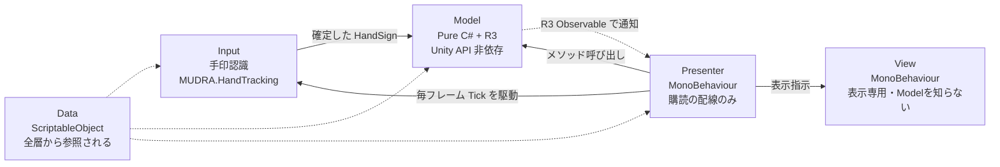
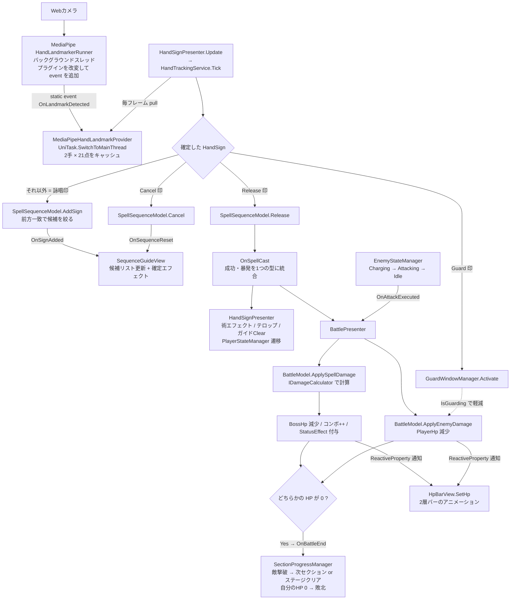

# 🗺️ アーキテクチャ概観：MUDRA

> **ドキュメント種別:** アーキテクチャ復習ドキュメント
> **作成日:** 2026/09/18
> **最終更新:** 2026/10/30（B7：サウンドを反映。B5：ゲームフロー、B6：キャリブレーション・チュートリアル、B6.5：InGame の 2.5D 化）
> **対象コミット:** `a64fc1f` 以降（B7）
> **対象コード:** `Assets/_MUDRA/Scripts`（125ファイル / 約13,440行。うちEditor拡張2本・約660行）
> **ステータス:** 現状スナップショット

---

## 0. このドキュメントの位置づけ

`docs/` には3種類のドキュメントがある。役割が違うので混ぜて読まないこと。

| ドキュメント | 役割 | 時制 |
|---|---|---|
| `specification_MUDRA.md`（v1.9） | **設計の正典。** 仕様駆動開発の基準であり、これから作るものも含む | 未来を含む |
| `devlog/dev_log_*.md` | 各マイルストーン完了時点の実装記録と設計判断の理由 | 当時の過去 |
| **本書（`architecture/`）** | **いま動いているコードの断面図。** どこに何があるかを思い出すための地図 | 現在 |

仕様書に書いてあるが未実装のものは [§8 仕様書とのギャップ](#8-仕様書とのギャップ簡易) にまとめてある。

- [01_hand_input.md](01_hand_input.md) — 手印認識パイプライン（Input層）の詳解
- [02_battle_system.md](02_battle_system.md) — Model / Presenter / View / Data の詳解
- [03_sound.md](03_sound.md) — BGM・効果音・音量設定（B7）。「この音はどこで鳴る？」の一覧もここ

---

## 1. 技術スタック

出典: `MUDRA/Packages/manifest.json`, `MUDRA/Assets/packages.config`

| 技術 | 用途 |
|---|---|
| Unity 6 + URP | 実行環境。Renderer をカメラ単位で使い分ける：App は 2D Renderer、InGame は Universal Renderer（B6.5 で InGame を 2.5D 化。[dev_log_B6.5](../devlog/dev_log_B6.5.md)） |
| **Cinemachine 3.1.7** | InGame のカメラ（仮想カメラ `CM_BattleCamera`）と揺れ（Impulse）。B6.5 |
| MediaPipeUnityPlugin | Webカメラからの手ランドマーク検出（21点 × 最大2手） |
| **R3**（NuGetForUnity経由） | Model → Presenter の通知。`ReactiveProperty` / `Subject` / `Observable` |
| **UniTask** | 非同期タイマー全般。敵行動ループ、硬直タイマー、スレッド切替 |
| **LitMotion** | View側のトゥイーン演出（HPバー、テロップ、確定エフェクト） |
| Unity Audio | AudioMixer（`MX_Main`。BGM / SE の音量）と Audio Random Container（効果音の音程・音量のばらつき）。B7（[03_sound](03_sound.md)） |
| TextMeshPro | UIテキスト。日本語フォントは ShipporiMinchoB1（本文・ボタン）、筆ごしらえ・衡山毛筆（見出し）、NotoSansJP（B4 までの HUD） |

DIコンテナは**使っていない**。手書きの Composition Root が2つある：App 側の `AppInitializer` と、バトル側の `BattleInitializer`（[§4](#4-起動シーケンス)）。

---

## 2. フォルダ構成

プロジェクト固有のコードは `Assets/_MUDRA/` 配下のみ。`Assets/` 直下のそれ以外（`MediaPipeUnity/`, `TextMesh Pro/`, `Packages/`）はサードパーティ。

```
Assets/_MUDRA/
├── Scenes/App.unity             … 起動シーン。終了まで常駐（カメラ・画面・遷移）
├── Scenes/InGame.unity          … バトル。InGame・Tutorial のたびに加算ロードし、終わったらアンロード
├── ScriptableObject/            … 術・敵・攻撃・ステージの定義アセット、演出の時間表・色（Presentation/）、固定の音（Sound/SND_Sound）
├── Audio/                      … BGM（BGM_Normalize/ ogg）・効果音（SE/ mp3）・ARC/・MX_Main（AudioMixer）。B7
├── Prefabs/ Particle/ Sprites/ Fonts/
└── Scripts/
    ├── Data/                    … ScriptableObject定義とenum
    │   SpellData / EnemyData / EnemyAttackData / EnemyAction / StageData(+StageSection) / SpellEnums
    │   PresentationTimingData（演出の時間表） / BattlePaletteData（意味の色） / SoundData（固定の音。B7） / BalanceData（全体の調整値。B8）
    ├── Input/                   … 手印認識（namespace MUDRA.HandTracking）
    │   IHandLandmarkProvider / MediaPipeHandLandmarkProvider
    │   HandTrackingService(約840行・中核) / HandLandmark / HandSignCandidate / FingerState / HandSignEnum
    │   └── HandTracking/TempHandTrackingRunner … 旧ドライバ（本番経路ではない）
    ├── Model/                   … Pure C#。Unity非依存のゲームロジック
    │   フロー:   GameStateManager+GamePhase+GameTransition / ProgressModel+SaveData+ISaveStorage
    │   バトル:   SpellSequenceModel / BattleModel / SpellCastResult / PlayerDamageInfo
    │             PlayerStateManager+PlayerPhase / EnemyStateManager+EnemyPhase
    │             SectionProgressManager+SectionPhase … ステージ内のセクション進行
    │             BattleEndModel（決着→Resultまでの待ち） / PauseModel+PauseReason
    │             BattleStatsModel+BattleStats / BattleRecord / RankCalculator+BattleRank
    │   カメラ:   CameraStatusModel+CameraStatus / HandPresenceModel / CalibrationModel（B6）
    │   練習:     TutorialModel+TutorialStep（B6）
    │   ├── State/               … プレイヤーのStateパターン（Idle/Chanting/Releasing）
    │   ├── StatusEffect/        … 時限効果（DoT/Stun/HoT）とガード受付窓
    │   └── Strategy/            … ダメージ計算3種
    ├── Persistence/             … JsonFileSaveStorage（ISaveStorage の実装。Unity API を使うので Model の外）
    ├── Presenter/               … Model購読 → View呼び出しの配線のみ
    │   App:    AppInitializer(起動) / GameFlowPresenter(遷移の実行) / ScreenPresenter / SettingsPresenter
    │           HandStatusPresenter / CalibrationPresenter（B6）/ CodexPresenter（図鑑）/ StageRecordFormat
    │   InGame: BattleInitializer(組み立て) / BattleContext / HandSignPresenter / BattlePresenter
    │           EnemyPresenter / PausePresenter / TutorialPresenter（B6）
    │   共有:   SceneNames
    ├── View/                    … 表示専用MonoBehaviour。Modelを知らない（詳細は 02 §12）
    │   画面:  ScreenView（基底） / TitleView / StageSelectView+StageCardView / ResultView / CalibrationView
    │          SettingsView / TransitionView（墨のワイプ） / DisplayModeView / CameraPreviewView
    │   HUD:   HpBarView / SequenceGuideView / SpellTelopView / DamageNumberView / ComboView
    │          StatusIconView / StageTitleView / StageIntroView / BattleResultView / GuardView / ScreenFlashView
    │          HandSignStatusView（判定中の印名＋確定ゲージ） / TutorialGuideView（B6）
    │   ポーズ: PauseMenuView / SpellListView / TimeScaleView（timeScale を書く唯一の場所）
    │   共通:  HandGuideView（「手が認識されません」。プレハブ `Prefabs/HandGuide`。B6）
    │   世界:  EnemyView / StageEnvironmentView（環境の生成とリグの移動） / SpellEffectView / CameraShakeView
    │   環境:  StageEnvironment（環境 Prefab のマーカー・霧） / TiledSurface（壁の繰り返し） / ScrollingTexture（絵を流す）
    │   ボス:  BossEncounterView
    │   音:    SePlayer（効果音。App と InGame に1つずつ） / BgmPlayer（App に常駐） / AudioVolumeView（Mixer の音量）。B7
    │   共有:  BattleUiConstants（調整対象でない共有値） / ElementNames
    ├── Debug/                   … #if UNITY_EDITOR || DEVELOPMENT_BUILD
    │   DebugKeyboardInput / DebugMenuView / ThumbAngleDebugger / HandTrackingActiveTest
    └── Editor/                  … ビルド対象外。ランタイムから参照しない
        B3ContentGenerator … 敵・攻撃・ステージSOの一括生成（メニュー MUDRA/Generate B3 Content）
        PlayFromAppScene   … InGame を開いて再生しても App から始める（メニュー MUDRA/Play From App Scene）
```

`.asmdef` は無く、全コードが `Assembly-CSharp` にコンパイルされる。**自動テストは存在しない**（`Debug/HandTrackingActiveTest.cs` はテストではなく毎フレームのログ出力）。

---

## 3. レイヤーと依存方向



| レイヤー | 規約 |
|---|---|
| **Input** | 唯一のMonoBehaviourは `MediaPipeHandLandmarkProvider`。`HandTrackingService` はPure C# |
| **Model** | **MonoBehaviour非継承・Unity API不使用**。テスト容易性のための方針（A1） |
| **Presenter** | ロジックを持たない。購読の配線と、確定した値をViewのメソッドに渡すだけ |
| **View** | Modelを参照しない。`SetHp(int,int)` のような命令的メソッドを公開するだけの受け身 |

**通知方向は常に Model → Presenter（R3購読）→ View（メソッド呼び出し）。** 逆流はしない。

---

## 4. 起動シーケンス

### 4-1. App（`AppInitializer.Awake`）

App 側の Model（`GameStateManager` / `ProgressModel` / `CameraStatusModel` / `HandPresenceModel`）を生成し、App の Presenter に注入する。
カメラ（MediaPipe と Provider）は App に常駐するので、バトルやリトライのたびに Webカメラと推論を再起動しない。

1. `GameStateManager` を生成（`_allStages` と `_tutorialStage`）。InGame が先に読み込まれていれば Title を飛ばす（§9 の起動の仕方）
2. `HandStatusPresenter.Initialize` — カメラと手の状態を毎フレーム実時間で判定し始める（B6）
3. Result への遷移で `ProgressModel.RecordBattle`（クリア記録の保存）を購読
4. `SettingsPresenter` → `CalibrationPresenter` → `CodexPresenter` → `ScreenPresenter` → `GameFlowPresenter` の順に注入（図鑑はステージ選択から開くので、ScreenPresenter より先に組み立てる）

### 4-2. 遷移（`GameStateManager` → `GameFlowPresenter`）

遷移は `GameStateManager`（Model）が決めて `OnTransition` を流し、`GameFlowPresenter` がキューで1つずつ実行する。

```
覆う → [From がバトル? → InGame をアンロード] → [To がバトル? → InGame を加算ロード → BattleInitializer.Initialize]
     → [バトルでなければ ScreenPresenter.ShowScreen] → 晴らす → BeginBattle（開始演出 → StartStage）
```

覆い始めに遷移の音、バトル以外の画面へ行く時はその画面の BGM（Result はリザルト曲、他はタイトル曲）を `GameFlowPresenter` が鳴らす。バトルの曲はバトル側（`EnemyPresenter`）が決める（[03 §3](03_sound.md)）。

「バトル」は InGame と Tutorial の2つ（`GameStateManager.UsesBattleScene`）。リトライは同じフェーズへの遷移で、アンロードしてから読み直すので、バトルの Model はすべて作り直される。
フローの全体は仕様書 §4-1。

### 4-3. バトル（`BattleInitializer.Initialize`）

App から `BattleContext`（ステージ・全ステージ・全術・Provider・GameStateManager・自動ポーズ設定・設定画面・`IsTutorial`・`HandPresence`・`Bgm`）を受け取って組み立てる。
生成するModelは**すべてステージ全体で生存**し、セクション遷移で作り直すものは無い（購読の張り直しが発生しない）。

1. **`ValidateStageData()`** — 開始ステージやその先頭セクションの敵が未設定なら中断
2. **`BuildStageScopeModels()`** — Model を生成。`EnemyStateManager` / `BattleModel` は開始ステージの先頭セクションの敵で初期化する
   - **循環依存の解消** — `StatusEffectFactory` に `BattleModel.ApplyDotDamage` / `ApplyHeal` / `EnemyStateManager.ApplyStun` / `EndStun` を **`Action` として**渡し、`BattleModel.SetStatusEffectDependencies()` で後から注入する（A5）
   - Tutorial の時だけ `TutorialModel` も生成し、`IsEnemyActive` を `EnemyStateManager.SetHeld` につなぐ（B6）
3. **`InjectPresenters()`** — 各Presenterへの注入と、デバッグメニューへの `Inject(...)`（`#if UNITY_EDITOR || DEVELOPMENT_BUILD`）
4. **`SubscribeStageEnd()`** — `OnStageCleared` / `OnGameOver` → `StatusEffectManager.ClearAll()` → `EnemyStateManager.StopLoop()`（この順序は意図的。Stun解除が走っても最後に必ず止まるようにする）。
   決着の演出を見せ終えたら（`BattleEndModel.OnFinished`）、通常は `EndBattle` で Result へ、Tutorial は勝てば `CompleteTutorial`・負ければ `Retry`
5. **`BeginBattle()`** — 遷移の覆いが晴れてから呼ばれる。開始演出の後に `SectionProgressManager.StartStage`。敵の流し込みと行動ループの開始はここから先（[02 §11](02_battle_system.md)）

`OnDestroy()` で `CompositeDisposable` と全Modelを `Dispose()` する。シングルトン・static は**プロジェクトコードには存在しない**（唯一の例外はMediaPipe側のstatic event、[01](01_hand_input.md) 参照）。

---

## 5. データフロー全体図



---

## 6. 毎フレーム駆動されているもの

Tick/Update で回るものと、UniTaskタイマーで動くものが明確に分かれている。

| 駆動元 | 呼ぶもの |
|---|---|
| `HandSignPresenter.Update()` | `HandTrackingService.Tick()` — 認識パイプライン全体（バトル中） |
| `CalibrationPresenter.Update()` | 認識テスト用の別の `HandTrackingService.Tick(unscaledDeltaTime)` — Calibration 画面を出している間だけ（B6） |
| `HandStatusPresenter.Update()` | `CameraStatusModel.Tick` / `HandPresenceModel.Tick`（実時間。ポーズ中も数える。B6） |
| `BattlePresenter.Update()` | `StatusEffectManager.Tick(deltaTime)` — DoT/Stunの時間経過 |
| `BattlePresenter.Update()` | `GuardWindowManager.Tick(deltaTime)` — ガード受付窓の残り時間 |
| UniTaskループ | `EnemyStateManager.RunLoopAsync` — 敵の行動サイクル |
| UniTaskタイマー | `ReleasingState` — 発動後250msの硬直 |
| UniTaskタイマー | `SectionProgressManager` / `BattleEndModel` / `PauseModel` / `TutorialModel` — 演出の尺だけ待つ（ゲーム内時間。ポーズ中は進まない） |

コルーチンと `async void` は使っていない。非同期は全てUniTask（`UniTaskVoid` + `.Forget()`、キャンセルは `CancellationTokenSource`）。

---

## 7. シーンとアセット

### App.unity（起動シーン・常駐）

| GameObject | 載っているもの |
|---|---|
| `AppSystem` | `AppInitializer` / `GameFlowPresenter` / `ScreenPresenter` / `SettingsPresenter` / `HandStatusPresenter` / `CalibrationPresenter` / `CodexPresenter` / `DisplayModeView` |
| `Solution` | MediaPipe の `HandLandmarkerRunner`（カメラ入力〜推論） |
| `MediaPipeHandLandmarkProvider` | `MediaPipeHandLandmarkProvider` ＋ 無効のテスト用2本 |
| `Main Canvas`（Overlay・order 0） | MediaPipe サンプル由来のカメラ映像（`Body/Annotatable Screen`）。`CameraPreviewView`（設定での表示切替、Calibration 中の強調表示） |
| `ScreenCanvas`（order 10） | `TitleScreen` / `StageSelectScreen` / `CodexScreen`（図鑑。ステージ選択の上に重ねて開く）/ `ResultScreen` / `CalibrationScreen`（認識テスト・エラーパネル・`HandGuide`） |

**図鑑（`CodexScreen`）:** ステージ選択の `C` / 図鑑ボタンで開く。タブ（術／妖）・一覧・詳細の3つで、`CodexPresenter` が開くたびに `SpellData` / `EnemyData` とクリア記録から中身を組む。
術は最初から全部、妖は出てくるステージをクリアしていれば解放（未解放は黒い影と「？？？」）。セーブに図鑑用の項目は無い。
数値は★5段階にぼかす（閾値は `CodexPresenter` 冒頭の定数）。説明文は各 SO の `description`（下書きと書き方の決まりは `docs/codex_text.md`）。
術アイコン（`Sprites/SpellIcon/`）は白地に黒い墨の絵で、和紙の台紙 `T_UI_IconPlate` に載せて円で切り抜く（`CodexImagePlate`。素材のプロンプトは `docs/spell_icon_prompts.md`）。
図鑑を閉じたキーをステージ選択が同じフレームで拾わないよう、`StageSelectView.Resume` と `CodexView.Show` はそのフレームのキー入力を読まない。
| `SettingsCanvas`（order 30） | 設定画面 |
| `TransitionCanvas`（order 100） | 墨のワイプ（`TransitionView`） |
| `Audio` | **唯一の AudioListener** / `SePlayer`（画面・UI の音）/ `BgmPlayer` / `AudioVolumeView`（B7。[03 §2](03_sound.md)） |
| `AppCamera` / `EventSystem` | EventSystem は App にだけ置く（InGame に置くと二重になる）。AudioListener はカメラではなく `Audio` に置く（B7） |

**キャンバスの並び順:** カメラ映像 0 < BattleCanvas 1 < 画面 10 < ポーズ 20 < 設定 30 < 遷移 100。Calibration の間だけカメラ映像を 15 に上げて画面より手前に出す（B6）。Build Settings は `[App, InGame]`。

`AppInitializer` の設定値: `_allStages` = SD_Stage01〜04 / `_tutorialStage` = SD_Tutorial / 術7種すべて。

### InGame.unity（バトル・加算ロード）

| GameObject | 載っているもの |
|---|---|
| `BattleSystem` | `BattleInitializer` / `HandSignPresenter` / `BattlePresenter` / `EnemyPresenter` / `PausePresenter` / `TutorialPresenter` / `TimeScaleView` |
| `BattleField`（ワールド） | `StageEnvironmentView`。実行時に環境 Prefab（`StageData.environmentPrefab`）を子に生成する |
| `BattleField/BattleRig` | マーカーへ移動する戦闘一式：`CM_BattleCamera`（`CinemachineCamera` FOV 60・z=-8.66 / Impulse Listener / 揺らぎ）/ `Enemy`（`EnemyView`、子に `Body`・`EffectSpawnPoint`・`FootShadow`）/ `PlayerEffectSpawnPoint` / `BossDimOverlay`（z=-7.5） |
| `BattleCanvas`（Overlay・HUD） | HPバー×2 / ガイド / テロップ / 数字 / コンボ / 状態アイコン / ステージ名 / 開始演出 / 決着 / フラッシュ / ガード枠 / ボス演出 / 判定中の印 / `TutorialGuide`（Tutorial の時だけ表示） |
| `PauseCanvas`（order 20） | ポーズボタン・メニュー・術一覧・手印早見表・`HandGuide`・カウントダウン（`PauseMenuView`） |
| `Main Camera` | Perspective、Renderer = `UniversalRenderer`。`CinemachineBrain`（位置・レンズは仮想カメラから写される）/ `CinemachineImpulseSource` / `CameraShakeView` |
| `BattleDebug` | `DebugMenuView` / `DebugKeyboardInput` |
| `BattleAudio` | `SePlayer`（戦闘の音。ポーズで一時停止する）。B7 |

**描画のルール（B6.5）:** 環境の板・床は URP/Unlit の不透明＋切り抜きで、前後は深度で決まる。敵・遠景の幕・術エフェクトは半透明（Sprite / Particle）で、Sorting Layer `Background` < `Enemy` < `Effect` が距離より優先される。HUD は Overlay の `BattleCanvas` で、カメラの移動・揺れの影響を受けない。霧はセクションごとに `StageEnvironmentView` が `RenderSettings` に書く（InGame シーン自体の霧は、ビルドで霧の機能が削られないよう「線形・オン・開始500」で保存）。詳細は [dev_log_B6.5 §4〜5](../devlog/dev_log_B6.5.md)。

**環境アセットの置き場所:** 環境 Prefab・マテリアル・パーティクルは `Assets/_MUDRA/Environment/`、素材画像は `Assets/_MUDRA/Sprites/Environment/Stage0N/`。生成プロンプトは `docs/stage0N_environment_asset_prompts.md`。Tutorial は Stage01 の環境を使う。

`BattleInitializer` の設定値: `_balance` = `BD_Balance`（PlayerMaxHp 100 ほか全体の調整値。B8）。ステージと術は App から `BattleContext` で受け取る。

### 術アセット（`ScriptableObject/Player/`）

B8 時点の値。ダメージの早見表（弱点時・確定数・敵の被ダメージ）は `docs/balance_sheet.md`。

| アセット | 術名 | シーケンス | 属性 | 威力 | 計算方式 | 副次効果 |
|---|---|---|---|---|---|---|
| WindBlade | 風刃 | 合 | Wind | 60 | SingleHit | — |
| CrossBlade | 双刃 | 双（両手チョキ） | Earth | 60 | SingleHit | — |
| WaterCrow | 水爪 | 刃 → 握 | Water | 100 | SingleHit | — |
| Halo | 光輪 | 握 → 開 | Light | 100 | SingleHit | — |
| Lightning | 雷連撃 | 指 → 刃 | Thunder | 85 | MultiHit ×5 | Stun 1.5秒（確率。B8） |
| Fireball | 火炎弾 | 掌 → 握 | Fire | 110 | DoT | DamageOverTime 3秒 |
| Heal | 回復術 | 開 → 掌 | Earth | 0 | SingleHit | HealOverTime 5秒（healPower 50） |
| IceWind | 氷風 | 開 → 指 → 握 | Wind | 140 | SingleHit | — |
| RockShatter | 岩砕 | 握 → 掌 → 刃 | Earth | 140 | SingleHit | — |
| PurifyingLight | 破魔光 | 握 → 開 → 掌 | Light | 140 | SingleHit | — |
| Hellfire | 業火 | 掌 → 握 → 指 → 開 | Fire | 175 | SingleHit | — |

### 敵・攻撃・ステージアセット

4ステージ / 敵15種（雑魚ユニーク8 + 派生3 + ボス4）/ 攻撃23種。加えてチュートリアル用に SD_Tutorial / ED_TrainingDummy（木人）/ EA_DummyStrike（B6）。ファイル名は `EA_` / `ED_` / `SD_` プレフィックス + 英語（仕様書 §3-2 の命名規則）。
数値の正は `Editor/B3ContentGenerator.cs` の定義表（B8 時点の早見表は `docs/balance_sheet.md`）。各敵の設計意図は `docs/B3_enemy_stage_content.md`（数値は B3 当時のもの）。**値の変更は `Editor/B3ContentGenerator.cs` の定義表を直して再実行する**（アセットを直接いじると次回の再実行で上書きされる）。

| ステージ | セクション（最後がボス） |
|---|---|
| SD_Stage01_SealedVillage 封土の里 | 泥ころ → 枯れ木霊 → **泥人形** |
| SD_Stage02_SunkenShrine 水底の社 | 河童 → 岩泥ころ → 蟹坊主 → **水蛇** |
| SD_Stage03_BurningTemple 焔の廃寺 | 鬼火 → 燃え木霊 → 火車 → **炎魔** |
| SD_Stage04_ShadowAbyss 影の深淵 | 影法師 → 影鬼火 → 鵺 → **影龍** |
| SD_Tutorial 修練場（stageNumber 0。`_allStages` には入れない） | **木人**（HP 3000・弱点 火・攻撃は木人打ちのみ） |

`isHeavy` は攻撃ごとに固定（同じ攻撃はどの敵が使っても大技か否かが変わらない）。生成スクリプトが攻撃テーブルから自動で設定する。

---

## 8. 仕様書とのギャップ（簡易）

仕様書 v1.9 に設計はあるがコードに存在しないもの。次に作るものの目次として使う。

| 未実装のもの | 仕様書の該当箇所 | 影響 |
|---|---|---|
| 本番のアート | §9-4 | 敵は既定スプライト＋名前から決めた色、背景は1枚の仮素材。木人（B6）も仮スプライト。`EnemyData.sprite` / `StageData` の背景 / `SpellData.cutInSprite` / `EnemyAttackData.effectPrefab` を差し替えるだけで入る |
| 印でのメニュー操作 | — | Title〜Result・Calibration・Tutorial のスキップはキーとマウスのみ（B5 からの持ち越し） |
| 手印の判定しきい値のキャリブレーション | — | Calibration（B6）はカメラと手が映るかの確認と認識テストまで。しきい値は C# の const 固定のまま |
| `StatusEffectType.Slow` | §3-1 | enumにあるが実装クラスが無い |

逆に**仕様書に無く実装が先行している**もの: `HandSign.DoubleScissors`（B2 Step3 の10本指パターン第1号）。

---

## 9. 開発再開ガイド

### とりあえず動かす

1. `Assets/_MUDRA/Scenes/App.unity` を開いて Play（InGame を開いて Play しても、`MUDRA/Play From App Scene` が ON なら App から始まる。OFF なら Title を飛ばしてバトルから）
2. Title →「はじめる」→ Calibration（手をかざして「次へ」）→ Tutorial（`Tab` でスキップ）→ StageSelect
3. 印は手を止めて約0.15秒同じ形を保つと確定する（B4.5）

### カメラ無しでテストする（推奨）

`HandSignPresenter` の `_debugKeyboardInput` に シーン上の `DebugKeyboardInput` を割り当てる。**現在は未割り当て = 通常のカメラモード**。割り当てると `HandTrackingService.Tick()` は回らなくなり、キー入力が直接 `HandleSignConfirmed` に流れる。

| キー | 印 |
|---|---|
| `1` `2` `3` `4` `5` | 開 / 握 / 指 / 刃 / 掌 |
| `U` | 合（Union） |
| `Space` | 発動印 |
| `Backspace` | 解除印 |
| `G` | ガード |
| `R` | リトライ（`GameStateManager.Retry`。InGame を読み直す） |
| `F2` | Calibration をカメラ無しで抜ける（`CalibrationView`） |
| `Tab` | Tutorial のスキップ（`TutorialGuideView`。デバッグ専用ではない） |

`F1` でデバッグメニュー（OnGUIオーバーレイ）— HP増減、StatusEffect強制付与、無敵モード、FPS表示。

### 新しい術を追加する

1. Project ビューで右クリック → `Create > MUDRA > SpellData`
2. `sequence` に詠唱印を並べる（発動印 `Release` は**含めない**）
3. App.unity の `AppInitializer` の `_allSpells` に登録する
4. 演出: `effectPrefab`（`Particle/Spell/PS_*.prefab` を参考に）と `element`（カットインの帯の色）を設定する。自分に掛ける術は `effectOnCaster` を true にする
5. 音: `castSE` に `SE_Cast_<アセット名>` を入れる。発動と命中は同じフレームなので、放つ音から当たる音までを1つの素材にする（[03 §8](03_sound.md)）

### 新しい印を追加する

1. `Input/HandSignEnum.cs` の **末尾に** 追加（後述の理由で既存値の並べ替えは禁止）
2. `HandTrackingService` の `SingleHandPatterns` または `TwoHandPatterns` に**1行追加**するだけで判定が通る
3. `View/SequenceGuideView.cs` の `GetSignDisplayName()` に表示用の漢字を追加（漏れると「？」になる。判定中の印の表示 `HandSignStatusView` もこれを使う）
4. キーボードテストしたいなら `Debug/DebugKeyboardInput.cs` にキーを追加

> **重要:** `HandSign` の整数値は `SpellData` アセットに**シリアライズ済み**（例: `sequence: 0600000001000000` = Palm, Fist）。既存の値を変更・並べ替えすると全アセットの意味が壊れる。追加は必ず末尾に。

---

## 10. コードを読むときの前提知識

| 慣習 | 内容 |
|---|---|
| **名前空間** | `MUDRA.HandTracking`（Input）/ `MUDRA.Data`（SpellData, SpellEnums）/ `MUDRA.Debugging`（ThumbAngleDebugger）。**それ以外はグローバル名前空間**（Model, Presenter, View, `HandSign`, `EnemyData` 等）。統一されていないので `using` が無くても探せば見つかる |
| **R3の使い分け** | イベント = `Subject<T>`、状態 = `ReactiveProperty<T>`。公開時は `Observable<T>` / `ReadOnlyReactiveProperty<T>` に絞る。購読は `CompositeDisposable _disposables` に集約し `OnDestroy` で破棄 |
| **命名** | private field は `_camelCase`、定数はクラス冒頭に `private const` として名前付きで置く（マジックナンバーを本文に埋めない） |
| **コメント** | ほぼ全ての型・publicメンバに日本語のXMLドキュメントコメント。**設計理由とマイルストーン番号（A1〜B2）が書き込まれている**ので、迷ったらまずソースのコメントを読むのが早い |
| **デバッグ分離** | `#if UNITY_EDITOR || DEVELOPMENT_BUILD` でファイル単位（`DebugKeyboardInput.cs`, `DebugMenuView.cs`）またはメンバ単位（`BattleModel.IsInvincible` 等）に囲う |
