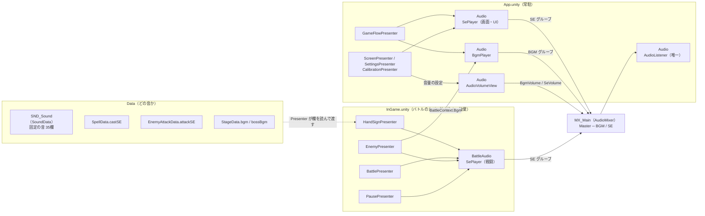

# 🔊 サウンド

> **ドキュメント種別:** アーキテクチャ復習ドキュメント
> **作成日:** 2026/10/30（B7）
> **対象:** `Scripts/View/SePlayer.cs` `BgmPlayer.cs` `AudioVolumeView.cs` / `Scripts/Data/SoundData.cs` / 各 Presenter の音の配線
> **関連:** [00_overview.md](00_overview.md) / [02_battle_system.md](02_battle_system.md) / 素材の一覧は [sound_asset_list.md](../sound_asset_list.md) / 作業の記録は [dev_log_B7.md](../devlog/dev_log_B7.md)

BGM と効果音が「どこで決まり、どこを通って、どこで鳴るか」の地図。

---

## 0. 目的別の入口

| やりたいこと | 見る所 |
|---|---|
| 全体の形をつかむ | [§1 全体図](#1-全体図) |
| ある音がどこで鳴っているか知りたい | [§5 発音ポイント一覧](#5-発音ポイント一覧) |
| 素材を差し替えたい・新しい術や敵に音を付けたい | [§8 作業ガイド](#8-作業ガイド) |
| 音が鳴らない・おかしい | [§10 困った時の確認順](#10-困った時の確認順) |
| なぜこういう作りなのか | [§9 設計判断](#9-設計判断) |

---

## 1. 全体図



押さえておくこと:

- **鳴らす部品は3つだけ。** 効果音の `SePlayer`（App と InGame に1つずつ）と、BGM の `BgmPlayer`（App に1つ）。どれも View で、Presenter から命令的に呼ばれる
- **どの音を鳴らすかは Data が持つ。** 固定の音は `SND_Sound`、術・敵の攻撃・ステージごとの音はそれぞれのアセット。Presenter は欄を読んで `SePlayer` / `BgmPlayer` に渡すだけ
- **音量は Mixer の2つのグループで決まる。** どのシーンの AudioSource も `MX_Main` の BGM か SE グループへ出力するので、App の `AudioVolumeView` が Mixer を書き換えれば InGame の音にも効く
- **AudioListener は App の `Audio` に1つだけ。** カメラには付けない（[§9](#9-設計判断)）

---

## 2. 構成要素

### 2-1. クラス

| クラス | 層 | 置き場所 | 役割 |
|---|---|---|---|
| `SoundData` | Data（`MUDRA.Data`） | `ScriptableObject/Sound/SND_Sound.asset` | 固定の音の欄。BGM・ジングルは `AudioClip`、効果音は `AudioResource`（溜めの音だけ `AudioClip`） |
| `SePlayer` | View | App `Audio` / InGame `BattleAudio` | 効果音を鳴らす。AudioSource を自分で作る（[§4](#4-効果音sepplayer)） |
| `BgmPlayer` | View | App `Audio` | BGM・ジングルを鳴らす（[§3](#3-bgmbgmplayer)） |
| `AudioVolumeView` | View | App `Audio` | 0〜1 の音量を Mixer のデシベルへ書き込む（[§6](#6-音量の設定)） |
| `ProgressModel` | Model | — | 音量の値を持ち、保存する（`BgmVolume` / `SeVolume`） |

音の欄を持つ他のデータ:

| アセット | 欄 | 型 |
|---|---|---|
| `SpellData` | `castSE` | `AudioResource`（術の発動〜命中を1つの音で。[§9](#9-設計判断)） |
| `EnemyAttackData` | `attackSE` | `AudioResource`（系統ごとの音を使い回す） |
| `StageData` | `bgm` / `bossBgm` | `AudioClip`。`bossBgm` が空ならボス戦でも `bgm` のまま |

### 2-2. シーンの配置

| シーン | GameObject | 付いているもの | 割り当て |
|---|---|---|---|
| App | `Audio` | `AudioListener` / `SePlayer` / `BgmPlayer` / `AudioVolumeView` | `SePlayer` → SE グループ、`BgmPlayer` → BGM グループ、`AudioVolumeView` → `MX_Main` |
| App | `AppSystem` | 各 Presenter の `_se` / `_sound` | `_se` は `Audio` の `SePlayer`。`GameFlowPresenter._bgmPlayer` は `Audio` の `BgmPlayer` |
| InGame | `BattleAudio` | `SePlayer` | SE グループ |
| InGame | `BattleSystem` | `HandSignPresenter` / `BattlePresenter` / `EnemyPresenter` / `PausePresenter` の `_se`（Pause は `_battleSe`）/ `_sound` | `_se` は `BattleAudio` の `SePlayer` |

- シーンの中に `AudioSource` は1つも無い。`SePlayer`（9個）と `BgmPlayer`（1個）が `Awake` で自分の GameObject に作る
- `BgmPlayer` は App にあるので、InGame からは `BattleContext.Bgm` で受け取る（シーンをまたぐ参照は Inspector で結べないため）

### 2-3. アセットの置き場所と命名

```
Assets/_MUDRA/Audio/
├── MX_Main.mixer          … Master の下に BGM / SE。公開パラメータ BgmVolume / SeVolume
├── BGM_Normalize/         … BGM・ジングル（ogg。取り込み前に音量をそろえてある）
│   BGM_Title / BGM_Result / BGM_Stage0N_* / BGM_Boss0N_* / JGL_Victory / JGL_Defeat
├── SE/                    … 効果音（mp3）。SE_* / SE_Cast_* / SE_EnemyAtk_*
└── ARC/                   … Audio Random Container。ARC_*（中身は SE/ の素材1つ）
Assets/_MUDRA/ScriptableObject/Sound/SND_Sound.asset
```

| 接頭辞 | 種類 |
|---|---|
| `BGM_` / `JGL_` | ループ曲 / 1回だけの曲（勝敗） |
| `SE_` | 効果音の素材ファイル |
| `SE_Cast_` + 術アセット名 | 術の発動音 |
| `SE_EnemyAtk_` + 系統 | 敵の攻撃音（Blunt / Slash / Water / Fire / Earth / Thunder / Curse / Bind） |
| `ARC_` + 元の素材名から `SE_` を除いたもの | Audio Random Container（例: `ARC_EnemyAtk_Fire`） |
| `MX_` | AudioMixer |
| `SND_` | `SoundData` アセット |

取り込み設定: BGM は **Streaming**（曲を丸ごとメモリに載せない）、効果音は Decompress On Load。どちらも Vorbis。

---

## 3. BGM（`BgmPlayer`）

### 3-1. 決まり

| 決まり | 理由 |
|---|---|
| AudioSource は1つ。切り替えは「フェードアウト（0.8秒）→ 次の曲を頭からフェードイン（0.5秒）」 | 重ねないので簡単。クロスフェードはしない |
| `Play(clip)` で**今と同じ曲なら何もしない** | 道中のセクションが変わるたびに呼ばれても頭に戻らない |
| `Play(null)` は `Stop()` と同じ | 曲が未設定のステージでも落ちない |
| フェードは**実時間**（LitMotion `UpdateIgnoreTimeScale`） | BGM はポーズ中も流す方針。ヒットストップでも止まらない |
| `PlayJingle(clip, delay)` は今の曲を止めて**ループなしで1回**鳴らす。`delay` は**ゲーム内時間**で待つ | 「討伐」の表示（`BattleResultView.ShowClear(delay)`）と同じ数え方にして揃える。ポーズで一緒に止まる |
| ジングル中に `Play` が来たら、**ジングルが鳴り終わるまで待ってから**次の曲を始める | 勝敗の音を途中で切らず、Result の曲と重ねない |
| ジングル前のフェードは、待ち時間が 0.8秒以上なら 0.8秒、それ未満なら 0.2秒 | ボス撃破（2秒待つ）はゆっくり消し、敗北（待たない）はすぐ消して鳴らす |
| 要求は後から来たものが勝つ（前のフェード・待ちは取り消す） | 遷移が続いても状態が残らない |

### 3-2. 曲が切り替わるタイミング

| 場面 | 曲 | 呼ぶ所 |
|---|---|---|
| 起動 → Title | タイトル曲 | `GameFlowPresenter.Initialize` |
| Title / Calibration / StageSelect へ | タイトル曲（同じ曲なので続く） | `GameFlowPresenter.RunTransitionAsync`（覆った後、バトル以外へ行く時） |
| Result へ | リザルト曲（ジングル中なら終わってから） | 同上 |
| バトルに入る（覆いの裏） | 前の曲を止める | `EnemyPresenter.PrepareStage` |
| 「結印！」の後、最初の敵が出る時 | 道中曲 | `EnemyPresenter.HandleSectionStarted` |
| ボス登場 | ボス曲（`bossBgm`。空なら道中曲のまま） | 同上 |
| 討伐 | 勝利ジングル（ボスなら撃破演出の後） | `EnemyPresenter`（`OnStageCleared`） |
| 敗北 | 敗北ジングル | `EnemyPresenter`（`OnGameOver`） |

画面ごとの曲は `GameFlowPresenter.ScreenBgm(phase)` が決める（Result だけリザルト曲、他はタイトル曲）。

### 3-3. ボス撃破から Result まで（ゲーム内時間）

```
0.0秒  ボス撃破（ヒットストップ → 0.3倍スロー）
       撃破音 SE_BossDefeat / ボス曲のフェードアウト開始（0.8秒）
2.0秒  「討伐」表示 ＋ 勝利ジングル            ← BossDefeatDuration
4.0秒  Result への遷移開始（覆い 0.5秒・実時間）← + resultHoldDuration
       Result 表示。リザルト曲はジングルが終わってから
```

敗北は 0秒で「敗北」と敗北ジングル、2.0秒で遷移開始。待ち時間は `PresentationTimingData` と `BattleEndModel` が決めていて、サウンド側は同じ値を使うだけ。

---

## 4. 効果音（`SePlayer`）

### 4-1. API

| メソッド | 中身 | 使う所 |
|---|---|---|
| `Play(sound, pitch = 1)` | 8個の AudioSource を順番に使い回して鳴らす。`sound` が null なら何もしない | ほぼ全部 |
| `PlayDelayed(sound, delay)` | **ゲーム内時間**で待ってから鳴らす。オブジェクトが消えたら鳴らさない | 時間表に合わせる音（咆哮・前進・「結印！」） |
| `PlayHeld(clip, duration)` / `StopHeld()` | 途中で止める音用の専用 AudioSource。`duration` 秒でちょうど鳴り終わるよう再生速度を `clip.length / duration`（0.5〜3倍）にする | 敵の攻撃の溜め |
| `SetPaused(bool)` | 鳴っている音だけ一時停止・再開。ポーズ中に新しく鳴らす音は普通に鳴る | ポーズ（InGame の `SePlayer` だけ） |

- **`PlayOneShot` を使わない理由:** Audio Random Container は `PlayOneShot` で鳴らせない（`AudioClip` しか受け取らない）。`AudioSource.resource` に入れて `Play()` するために、AudioSource を数個用意して使い回している
- 同時に9つ目が来たら、一番古い音を止めて使い回す
- `PlayHeld` は長さを読むので `AudioClip` 専用。`SND_Sound.enemyCharge` だけ型が `AudioClip` なのはこのため

### 4-2. Audio Random Container（ARC）

繰り返し鳴る音は ARC にして、毎回わずかに音程と音量を変えている（同じ音の繰り返しで機械的に聞こえないように）。

| ARC | 音程の幅（cent） | 音量の幅（dB） |
|---|---|---|
| `ARC_GuardSuccess` / `ARC_PlayerDamage` / `ARC_PlayerDamageHeavy` / `ARC_EnemyDefeat` | ±100 | ±2 |
| `ARC_EnemyAtk_*`（8系統） | ±100 | ±2 |
| `ARC_DotTick` | −150〜+100 | ±2 |
| `ARC_HitWeakness` / `ARC_UiCursor` | ±50 | ±2 |

- 100 cent が半音1つ
- **ARC にしない音:** 印の確定（再生側で印の数に応じて音程を上げるので、既に毎回違う）、術8種（術の個性を保つ）、溜め（`AudioClip` 専用）、ジングル・「結印！」・ボスの登場と撃破などの1回きりの演出、UI の決定・戻る
- ARC の `Trigger` は必ず **Manual**（Automatic にすると1回の `Play` で鳴り続ける）
- ARC の中身（入れる音・幅）はコードから設定できないので、エディタで作る（[§8](#8-作業ガイド)）

### 4-3. 時間の扱い

| 処理 | 時間 | ポーズ中 | ヒットストップ・スロー中 |
|---|---|---|---|
| `BgmPlayer` のフェード | 実時間 | 進む | 進む |
| `BgmPlayer.PlayJingle` の待ち | ゲーム内時間 | 止まる | 遅くなる（表示と揃う） |
| `SePlayer.PlayDelayed` の待ち | ゲーム内時間 | 止まる | 遅くなる |
| 鳴っている音そのもの | AudioSource は timeScale の影響を受けない | 戦闘の音だけ `SetPaused` で止める | 止まらない（通常の速さで鳴る） |
| 溜めの音の長さ合わせ | `chargeTime`（ゲーム内時間）で計算 | 一時停止される | わずかにずれる（許容） |

---

## 5. 発音ポイント一覧

**ここがこのドキュメントの本体。** 「この音はどこで鳴る？」はここで引く。欄の名前は `SND_Sound` のもの（`castSE` などは各アセットのもの）。

### HandSignPresenter（InGame）

| きっかけ | 鳴らす音 | 備考 |
|---|---|---|
| `SpellSequenceModel.OnSignAdded` | `signConfirm` | 音程を `2^(2×(印の数−1)/12)` 倍。1つ目は元の高さ、以降1つごとに2半音上げる（`SignPitchSemitoneStep`） |
| `OnSpellCast`（成功） | その術の `castSE` | 発動と命中は同じフレームなので、命中の音もこれに含める |
| `OnSpellCast`（暴発） | `misfire` | 暴発の自傷ダメージでは被弾音を鳴らさない |
| `OnSequenceReset` | `signCancel` | 解除印 |

### BattlePresenter（InGame）

| きっかけ | 鳴らす音 | 備考 |
|---|---|---|
| `BattleModel.OnSpellHit`（`TotalDamage > 0` かつ `IsWeakness`） | `hitWeakness` | 術の音に重ねる唯一の共通音 |
| `GuardWindowManager.IsGuarding` が true に | `guardStance` | |
| `BattleModel.OnDotTick` / `OnHealed` | `dotTick` / `healTick` | 毎秒 |
| `EnemyStateManager.OnAttackExecuted` | その攻撃の `attackSE` | 結果の音（下の行）と重ねる |
| `BattleModel.OnPlayerDamaged` | ガード成功 → `guardSuccess`、大技 → `playerDamageHeavy`、通常 → `playerDamage` | 暴発（`IsMisfire`）なら鳴らさない |

### EnemyPresenter（InGame）

| きっかけ | 鳴らす音 | 備考 |
|---|---|---|
| `PlayStageIntroAsync` | `stageIntro` → `introTitleDuration` 後に `ketsuin` ＋ `ketsuinVoice` | 帯と同時 →「結印！」と同時 |
| `PrepareStage` | BGM を止める | 覆いの裏 |
| `OnSectionStarted` | BGM（道中 / ボス）。ボスなら `bossAppear` → `roar` 秒後に `bossRoar`、雑魚なら `enemyAppear` | |
| `CurrentAction`（Charging） | `enemyCharge` を `PlayHeld(clip, chargeTime)`。ボスの大技なら `heavyWarning` も | 頂点が攻撃の瞬間に来る |
| `CurrentPhase` が Charging 以外に | `StopHeld()` | 攻撃・Stun・待機・ループ停止のどれでも止める |
| `OnSectionCleared` | ボス → `bossDefeat`、雑魚 → `enemyDefeat`。次があれば `NormalDefeatDuration` 後に `advance` | |
| `OnStageCleared` | `PlayJingle(victoryJingle, ボスなら BossDefeatDuration)` | 「討伐」と同時 |
| `OnGameOver` | `PlayJingle(defeatJingle)` | 「敗北」と同時 |

### PausePresenter（InGame）

| きっかけ | 鳴らす音 | 備考 |
|---|---|---|
| `PauseModel.IsPaused` | `SePlayer.SetPaused`。true なら止めた後に `pause` | BGM は止めない |
| `PauseMenuView.OnCountdownTick` | `countdownTick` | 3・2・1 のそれぞれ |
| `PauseMenuView.OnResumeCall` | `ketsuin` ＋ `ketsuinVoice` | 再開の「結印！」 |
| 設定・リトライ・ステージ選択 | `uiDecide` | リトライ・ステージ選択は受け付けられた時だけ。再開はすぐ刻みが鳴るので鳴らさない |

### App 側

| Presenter | きっかけ | 鳴らす音 |
|---|---|---|
| `GameFlowPresenter` | 遷移で覆い始める | `transition` |
| `ScreenPresenter` | Title のスタート・設定 / ステージ決定 / Result の3つのボタン | `uiDecide` |
| | ステージ選択の戻る | `uiBack` |
| | `StageSelectView.OnCursorMoved` | `uiCursor` |
| | `ResultView.OnRankStamped` | `rankStamp`（自己ベストなら `newRecord` も） |
| `SettingsPresenter` | 3つの切り替え / 閉じる | `uiToggle` / `uiBack` |
| | 効果音のスライダー | `uiCursor`（新しい音量で確認できるよう、反映してから鳴らす） |
| `CalibrationPresenter` | 印の認識 | `signConfirm`（音程は上げない） |
| | 次へ・やり直し / 戻る | `uiDecide` / `uiBack` |

### View が出す「合図」

時刻を View の中で決めている演出は、View が合図（Observable）を出し、Presenter がそれを受けて鳴らす。時間の値を Presenter に書き写さないため。

| View | 合図 | いつ |
|---|---|---|
| `PauseMenuView` | `OnCountdownTick` / `OnResumeCall` | 数字が出るたび / 「結印！」が出た時 |
| `ResultView` | `OnRankStamped` | ハンコが縮みきった瞬間（`WithOnComplete`） |
| `StageSelectView` | `OnCursorMoved` | キーでカーソルが別のカードへ動いた時（初期位置では出ない） |

一方、時刻が `PresentationTimingData` にある演出（咆哮・前進・「結印！」）は、Presenter が `SePlayer.PlayDelayed` に同じ値を渡す。

---

## 6. 音量の設定

```
SettingsView のスライダー（0〜10 の整数）
  → OnBgmVolumeChanged / OnSeVolumeChanged（0〜1）
  → ProgressModel.SetBgmVolume / SetSeVolume（0〜1 に収めて保存）
  → BgmVolume / SeVolume（ReactiveProperty）
  → SettingsPresenter → SettingsView.SetBgmVolume（表示。合図は出さない）
                     → AudioVolumeView.SetBgmVolume（Mixer の BgmVolume へ）
```

| 項目 | 値 |
|---|---|
| 既定値 | BGM 0.7 / 効果音 1.0（`SaveData.SettingsData`。古いセーブファイルにはこの項目が無いので既定値になる） |
| デシベルへの変換 | `20 × log10(音量)`。0 は −80dB（無音） |
| 起動直後 | `Awake` 中の `AudioMixer.SetFloat` は無視されることがあるため、`AudioVolumeView` は値を覚えておき `Start` でもう一度書く |
| Mixer の公開パラメータ名 | `BgmVolume` / `SeVolume`（`AudioVolumeView` の `private const`。Mixer 側で名前を変えたらここも直す） |

---

## 7. ポーズ

- `PausePresenter` が `IsPaused` を受けて `TimeScaleView.SetPaused` と `SePlayer.SetPaused`（InGame の `BattleAudio`）を呼ぶ
- 止まるのは**その時点で鳴っている戦闘の音だけ**。ポーズ中に鳴らす音（ポーズ音・カウントダウン・メニューの決定）は同じ `SePlayer` から普通に鳴る
- **BGM・App の UI 音は止まらない**（`BgmPlayer` と App の `SePlayer` は `SetPaused` を呼ばれない）
- `AudioListener.pause`（全体の一時停止）は使わない。InGame がポーズ中にアンロードされても、全体の状態を戻し忘れる心配がない

---

## 8. 作業ガイド

### 素材を差し替える

1. 新しい素材を `Audio/SE/`（効果音）か `Audio/BGM_Normalize/`（BGM）に入れる
2. 同じ名前・同じ拡張子で上書きすれば、割り当てはそのまま（GUID が変わらない）。**拡張子を変えると別ファイル扱いになり、割り当てが外れる**ので、欄に入れ直す
3. その音が ARC 経由なら、`Audio/ARC/ARC_*` の中身の素材を差し替える

### 新しい術に音を付ける

`SpellData.castSE` に `SE_Cast_<術アセット名>` を入れる。**放つ音から当たる音までを1つの素材にする**（発動と命中は同じフレーム）。MultiHit の術は、ヒット数ぶん鳴る素材にする。

### 新しい敵の攻撃に音を付ける

`EnemyAttackData.attackSE` に系統の `ARC_EnemyAtk_*` を入れる。当たった結果の音（被弾・ガード成功）は自動で重なるので、攻撃音は当たりの強い音を含まないものがよい。新しい系統が要るなら `SE_EnemyAtk_<系統>` と `ARC_EnemyAtk_<系統>` を作る。

### 新しいステージに曲を付ける

`StageData.bgm`（道中）と `bossBgm`（ボス）を入れる。`bossBgm` を空にするとボス戦でも道中の曲が続く。

### 新しい種類の音を足す（コードの変更が要る）

1. `SoundData` に欄を足す（`AudioResource`。途中で止める音なら `AudioClip`）。Tooltip に素材のファイル名を書く
2. 鳴らす Presenter で `_se.Play(_sound.欄)` を呼ぶ。InGame の音は `BattleAudio` の、App の音は `Audio` の `SePlayer` から鳴らす
3. 時刻が View の中で決まる演出なら、その View に合図（`Subject<Unit>` ＋ `Observable<Unit>`）を足して Presenter で受ける。時刻が `PresentationTimingData` にあるなら `PlayDelayed` を使う
4. `SND_Sound` に素材を入れ、[sound_asset_list.md](../sound_asset_list.md) にも行を足す

### ARC を作る

1. `Audio/ARC/` で右クリック → Create → Audio → Audio Random Container。名前は `ARC_<元の素材名から SE_ を除いたもの>`
2. Clips に元の素材を入れる。Pitch と Volume の Randomize を有効にして幅を入れる（[§4-2](#4-2-audio-random-containerarc) の表が目安）
3. Trigger は **Manual** のまま
4. 欄（`SND_Sound` や `attackSE`）の素材を ARC に差し替える

---

## 9. 設計判断

| 判断 | 理由 | 選ばなかった案 |
|---|---|---|
| **1つの術に1つの音**（放つ〜当たるまで） | `OnSpellCast` → `ApplySpellDamage` → `OnSpellHit` が同じフレームで起き、見た目も同時。別々の音を重ねると最大7音が同時に鳴る | `SpellData.hitSE` を足して属性別のヒット音を重ねる |
| 術の瞬間に重ねる共通音は**弱点だけ** | 「弱点だった」は耳で知る価値がある。迅速・コンボ・スタンは画面に出るので省いても情報が失われない | 共通の発動音・迅速・コンボ・スタンの音（`SoundData` から削除。共通の命中音 `hit` だけ予備として欄を残す） |
| 敵の攻撃は**攻撃音＋結果の音** | 「守れたか」が遊びの核なので結果の音は外せない。攻撃の個性は系統の音で出す | 結果の音だけ / 攻撃音だけ |
| 溜めの音は**再生速度で溜め時間に合わせる** | せり上がる音の頂点を攻撃の瞬間に合わせ、ガードのタイミングを耳で取れるようにする | 固定の長さで鳴らして攻撃で切る |
| AudioListener は **App の `Audio` に1つ** | カメラに付けると、InGame を読み込んでから App のカメラを止めるまでの間に2つ重なって警告が出る（B6.5 の宿題）。音はすべて 2D なので聞く位置は関係ない | 両カメラに付けて切り替える |
| `BgmPlayer` は **App に常駐** | InGame の読み込み・破棄をまたいで鳴り続け、切り替えを1か所で管理できる | バトル用の BGM 再生役を InGame に置く |
| ステージの曲は **「結印！」の後**から | 開始演出の間は拍子木と太鼓だけにして、曲の始まりを敵の登場と揃える | 覆いの裏でステージ曲を始める |
| ジングル中の曲の要求は**待つ** | 勝敗の音を途中で切らない。Result に少し割り込むのは許容 | Result に入ったらジングルを消す |
| 音量は **AudioMixer** で | App と InGame の `SePlayer` の両方に効かせるのに、値をシーン越しに受け渡す必要がない | 各 AudioSource の volume を掛け算する（`BattleContext` で値を渡して購読） |
| ポーズは **`SePlayer.SetPaused`** | シーンと一緒に消えるので、全体の状態を戻し忘れない。ポーズ中の音も同じ部品から鳴らせる | `AudioListener.pause` ＋ `ignoreListenerPause` |
| 効果音の欄は **`AudioResource`** | 素の素材でも ARC でも同じ欄に入り、コードは変わらない | `AudioClip` |

---

## 10. 困った時の確認順

| 症状 | 確認すること |
|---|---|
| ある音だけ鳴らない | ①`SND_Sound` か各アセットの欄が空でないか（空は鳴らさないだけでエラーも出ない）②[§5](#5-発音ポイント一覧) のきっかけが実際に起きているか |
| 全部の効果音が鳴らない | 設定の効果音が 0 でないか。`SePlayer` の `_outputGroup` が SE グループか。Presenter の `_se` が割り当てられているか |
| BGM が鳴らない | 設定の BGM が 0 でないか。`GameFlowPresenter._bgmPlayer` と `_sound`。ステージの `bgm` が空でないか |
| 音量スライダーが効かない | `MX_Main` の公開パラメータ名が `BgmVolume` / `SeVolume` か |
| 1回鳴らしただけで鳴り続ける | その ARC の Trigger が Automatic になっていないか |
| ポーズ中に戦闘の音が鳴り続ける | `PausePresenter._battleSe` が `BattleAudio` の `SePlayer` か |
| 「AudioListener が2つある」警告 | カメラなどに AudioListener を足していないか（App の `Audio` 以外に置かない） |
| 溜めの音が攻撃の瞬間に頂点まで届かない | 素材が長すぎて再生速度が上限（3倍）に当たっている。1.5〜2秒の素材にする |

---

## 11. 未対応・保留

| 項目 | 状態 |
|---|---|
| 空の欄 | `healTick` / `ketsuinVoice` / `newRecord`（鳴らないだけ） |
| 代わりの素材 | `bossRoar` に `SE_BossDefeat`、`uiToggle` に `SE_UiDecide` |
| 長い素材 | `SE_EnemyCharge`（3.3秒）/ `SE_SignConfirm`（2.5秒）/ `SE_BossDefeat`（6.9秒）/ `SE_Advance`（10秒）など。プレイで違和感が出たら都度切る方針 |
| 効果音の形式 | mp3 のまま（頭に短い無音が入ることがある。気になれば ogg に揃える） |
| ジングルの長さ | 勝利 7.1秒・敗北 14.8秒。Result の曲はジングルが終わってから始まる |
| 共通の命中音 `hit` | 欄と素材はあるが鳴らしていない（予備） |
| チュートリアルの段階クリアの音 | 鳴らさないと決めた |
