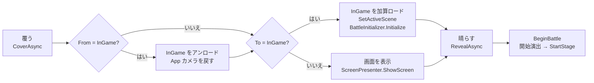

# 📋 開発ログ：β版 B5（ゲームフロー実装）

> **ドキュメント種別:** マイルストーン開発ログ
> **対象フェーズ:** β版 B5
> **期間:** 2026/10/11〜10/21
> **ステータス:** ✅ 完了（コミット済み）

---

## 1. 概要

| 項目 | 内容 |
|------|------|
| **出発点** | InGame.unity を直接起動するしかなく、決着すると「討伐/敗北」を出したまま止まる |
| **完了条件** | Title → StageSelect → InGame → Result → StageSelect/Title が画面遷移でひと回りし、ポーズとリジュームが動く |
| **仕様書の内訳に足したもの** | ポーズメニュー（リトライ・画面移動・設定）、自動ポーズ、ポーズ中の術一覧、クリア記録の保存、設定画面、戦績とランク、敗北時のヒント、ボス撃破のスロー、ステージ開始演出、墨のワイプ、ビルドの先行確認 |
| **B5中に入った B5 外の作業** | 判定中の印の表示（`HandSignStatusView`）、ステージ2〜4の背景と敵の絵、術の威力の引き上げ |
| **進め方** | 計画を一括で承認してもらい、Step 1〜6 を続けて実装した。C# は手で書き、シーン・アセットは Unity MCP で組んだ。Play モードでの確認はユーザーが行った |
| **後回しにしたもの** | 印でのメニュー操作（仕様決めから。§9） |

### 規模
自前コードは 66 ファイル・約 7,100 行から **105 ファイル・約 10,400 行**になった。増えた分のほとんどは App 側の画面と、それを動かす Model・Presenter。

---

## 2. 全体像

### 2-1. シーン構成：常駐する App ＋ InGame の加算ロード

```
App.unity（起動シーン。終了まで残る）
├ AppSystem       … AppInitializer / GameFlowPresenter / ScreenPresenter / SettingsPresenter / DisplayModeView
├ Solution + MediaPipeHandLandmarkProvider     … InGame から移した
├ Main Canvas（カメラ映像。Overlay / order 0）  … InGame から移した。CameraPreviewView を追加
├ EventSystem / AppCamera（AudioListener 付き）
├ ScreenCanvas（order 10）     … Title / StageSelect / Result
├ SettingsCanvas（order 30）   … 設定画面
└ TransitionCanvas（order 100）… 墨のワイプ

InGame.unity（バトルのたびに加算ロードし、終わったらアンロード）
├ BattleSystem … BattleInitializer / 各 Presenter / TimeScaleView / PausePresenter
├ BattleCanvas … HUD ＋ StageIntro
└ PauseCanvas（order 20）… ポーズボタン・メニュー・術一覧・カウントダウン
```

キャンバスの並び順は、カメラ映像 0 < 画面 10 < ポーズ 20 < 設定 30 < 遷移 100。Build Settings は `[App, InGame]`。

### 2-2. 1回の遷移の流れ

`GameStateManager`（Model）が遷移を決めて `OnTransition` を流し、`GameFlowPresenter` が次の順に実行する。



- 遷移は**キューで1つずつ**処理する。演出の途中で次の遷移が来たら（決着の直後に R など）、今のものを終えてから続ける。途中で割り込むと、ロードとアンロードが交錯するため
- リトライは InGame → InGame（`IsReload`）。アンロードしてから読み直すので、バトルの Model はすべて作り直される
- バトルの Model は `BattleContext`（ステージ・全ステージ・全術・Provider・GameStateManager・自動ポーズ設定・設定画面）にまとめて App から渡す。static は使っていない

### 2-3. 起動の仕方は3通り

| 起動の仕方 | 動き |
|---|---|
| App を開いて再生 | Title から始まる（製品と同じ） |
| InGame を開いて再生（`MUDRA/Play From App Scene` が ON。初期値） | エディタ拡張 `PlayFromAppScene` が再生開始シーンを App に差し替えるので、Title から始まる |
| InGame を開いて再生（上のメニューが OFF） | `BattleInitializer.Start` が App を加算ロードする。`AppInitializer` は InGame がもう読み込まれていることに気付き、Title を飛ばして `_debugStartStage`（未設定なら先頭ステージ）でバトルを始める |

メニューの ON/OFF は EditorPrefs に保存されるので、PC ごとの設定になる。

---

## 3. 機能ごとの実装

### 3-1. ゲームフローの骨格

| ファイル | 内容 |
|----------|------|
| `Model/GamePhase.cs` | `Title, StageSelect, InGame, Result`。B6 の Calibration/Tutorial は末尾に足す |
| `Model/GameTransition.cs` | From・To・`IsReload` |
| `Model/GameStateManager.cs` | 現在のフェーズと遷移イベント。`StartGame / SelectStage / EndBattle / Retry / ToStageSelect / ToTitle` は、許されていない遷移なら false を返して何もしない。`SelectedStage`・`LastRecord` を持つ |
| `Model/BattleEndModel.cs` | 決着してから Result へ移るまでの待ち。待ち終わると `OnFinished(isWin)`。デバッグのジャンプでセクションが始まったら取り消す |
| `Presenter/AppInitializer.cs` | App 側の生成と注入。GameStateManager・ProgressModel を作り、Result への遷移で記録を保存する |
| `Presenter/GameFlowPresenter.cs` | 2-2 の流れ。InGame を読み込んでいる間は App のカメラを止める |
| `Presenter/BattleContext.cs` / `SceneNames.cs` | 受け渡し用の入れ物と、シーン名の定数 |
| `Presenter/BattleInitializer.cs` | Awake での組み立てをやめ、`Initialize(BattleContext)` と `BeginBattle()` に分けた。`_allStages`・`_allSpells` は Context から受け取る |
| `Debug/DebugKeyboardInput.cs` / `DebugMenuView.cs` | R と F1 メニューの「リトライ」を、シーンの再読込から `GameStateManager.Retry` に変えた |
| `Editor/PlayFromAppScene.cs` | 2-3 の再生開始シーンの切り替え |

### 3-2. 画面

| ファイル | 内容 |
|----------|------|
| `View/ScreenView.cs` | 画面の基底。CanvasGroup で表示を切り替え、`Lock()` で表示したまま操作だけ止める |
| `View/TitleView.cs` | スタート・設定。Space / Enter でスタート |
| `View/StageSelectView.cs` / `StageCardView.cs` | カード4枚（ステージ名・ボス名・弱点属性・クリア記録）。1〜9 で選び Space で決定、Backspace / Esc で戻る |
| `View/ResultView.cs` | 勝敗・戦績7項目・ランク（判子の演出）・新記録。敗北時はランクの代わりにヒント。Space でもう一度、Backspace でステージ選択へ |
| `Presenter/ScreenPresenter.cs` | 各画面を GameStateManager につなぐ。カードと Result の表示用データもここで作る |
| `View/ElementNames.cs` | 属性の表示名（火・水…） |

敗北時のヒントは「ボスの弱点属性」と「その属性の術（印の並び）」から作る。例:「○○は水に弱い。水爪（刃 → 握 → 発）」。

### 3-3. ポーズ

| ファイル | 内容 |
|----------|------|
| `Model/PauseModel.cs` / `PauseReason.cs` | ポーズ中か・再開のカウントダウン中か・ポーズした理由。`AcceptsBattleInput`（開始後かつポーズしていない）を公開する |
| `View/TimeScaleView.cs` | `Time.timeScale` を書き換える**唯一の場所**（§4-3） |
| `Presenter/PausePresenter.cs` | ポーズの開閉と自動ポーズの配線。フォーカスの喪失と、手が映っているかを Model に渡す |
| `View/PauseMenuView.cs` | 左上のポーズボタン、メニュー（再開・リトライ・ステージ選択へ・設定）、カウントダウン「3・2・1・結印！」。Esc で開閉 |
| `View/SpellListView.cs` | ポーズ中の術一覧（術名・属性・印の並び） |
| `Presenter/HandSignPresenter.cs` | 入口で `AcceptsBattleInput` を確かめ、受け付けない間の印は捨てる |

- **自動ポーズ:** ウィンドウのフォーカスを失ったとき、手が5秒映らないとき。設定でオフにできる。キーボードモードでは手の判定をしない
- **再開:** すぐには戻さず、3秒のカウントダウン（実時間）を挟む。ポーズ中は手を下ろしていることが多いので、構え直す時間が要る

### 3-4. 戦績とランク

| ファイル | 内容 |
|----------|------|
| `Model/BattleStatsModel.cs` | 既存の通知を購読して集計する。時間は Tick で積むので、ポーズ中・開始演出中は進まない |
| `Model/BattleStats.cs` | 時間・最大コンボ・弱点ヒット・ガード成功・術の発動数・暴発・被ダメージ |
| `Model/BattleRecord.cs` | ステージ・勝敗・戦績・ランク（クリア時のみ）・最後に戦った敵 |
| `Model/BattleRank.cs` / `RankCalculator.cs` | C=0, B, A, S。100点からの加減点（下表） |

| 項目 | 点 |
|---|---|
| 被ダメージ | 最大HP分の被弾で −60 |
| 暴発 | 1回 −5 |
| 最大コンボ | 1 につき +2（10まで） |
| 弱点ヒット | 1回 +1（10回まで） |
| ガード成功 | 1回 +2（5回まで） |
| しきい値 | S ≥ 100 / A ≥ 80 / B ≥ 60 / それ未満 C |

時間はステージごとに長さが違うので点に入れず、表示だけにした。数値は仮で、B8 で詰める。

### 3-5. セーブと設定

| ファイル | 内容 |
|----------|------|
| `Model/SaveData.cs` | ステージごとの記録（ステージ番号・クリア済み・ベストランク・ベストタイム）と、設定3項目 |
| `Model/ISaveStorage.cs` | 読み書きの窓口。Model はこれしか知らない |
| `Persistence/JsonFileSaveStorage.cs` | `JsonUtility` で `persistentDataPath/save.json` に書く。一時ファイルに書いてから置き換える（書き込み中に落ちても壊れない）。読めない・無いときは初期状態で始める |
| `Model/ProgressModel.cs` | 記録の更新と新記録の判定、設定値。ステージ解放の判定 `IsUnlocked` は今は常に true |
| `Presenter/SettingsPresenter.cs` / `View/SettingsView.cs` | 設定画面。Title とポーズメニューの両方から開く |
| `View/DisplayModeView.cs` / `CameraPreviewView.cs` | フルスクリーン切り替え（エディタでは効かない）と、カメラ映像の表示 |

ベストの更新は「ランクが上がった」か「同じランクでタイムが縮んだ」とき。敗北は記録しない。

### 3-6. 演出

| ファイル | 内容 |
|----------|------|
| `View/TransitionView.cs` | 墨で払うワイプ。黒い面（Fill）の端に擦れた縁（Edge）を付けて左から右へ動かす。縁の `Sprites/UI/InkEdge.png` は仮素材 |
| `View/StageIntroView.cs` | ステージ開始演出。「其の一 ステージ名／ボス・弱点」→「結印！」。終わってから `StartStage` を呼ぶ |
| `Presenter/EnemyPresenter.cs` | 開始演出の呼び出し。ヒットストップの呼び先を TimeScaleView に変えた。`PrepareStage` で開始前に背景を差し替え、敵を隠す |
| `View/BossEncounterView.cs` | ヒットストップを TimeScaleView へ移した |
| `Data/PresentationTimingData.cs` | 遷移・開始演出・Result までの待ち・ボス撃破のスロー・再開カウントダウンの尺を追加 |
| `Data/StageData.cs` | `FindBoss()`（最後のボスセクションの敵） |

ボスを倒すと、ヒットストップの後に 0.3 倍速のスローを実時間で 0.8 秒入れる。Result へは、撃破演出の後さらに 2 秒置いてから移る。

### 3-7. ビルドの準備

- MediaPipe のモデル `hand_landmarker.bytes` を `Assets/StreamingAssets/` に置き、`AppSettings` の読み込み方式を Local（エディタ専用）から StreamingAssets（値は 0）にした。Local のままだと、ビルドした exe で手の認識がまったく動かない
- Build Profile `Settings/Build Profiles/Windows.asset` を追加した

### 3-8. B5 の外で入った作業

| 内容 | ファイル |
|---|---|
| 判定中の印の表示。カメラ映像の上に「今読まれている印の名前」と「確定までのゲージ」を出し、確定でポップさせる。確定するまで何の印として読まれているか分からず、組み直すか待つかを判断できなかったため | `Input/HandSignCandidate.cs`（新規）、`Input/HandTrackingService.cs`（`Candidate` を公開）、`View/HandSignStatusView.cs`（新規）、`Presenter/HandSignPresenter.cs`、`View/SequenceGuideView.cs`（発・散・盾の表示名） |
| ステージ2〜4の背景（道中・ボス）と、敵14体の絵 | `Sprites/Background/`、`Sprites/Enemy/`、`StageData`・`EnemyData` の各アセット |
| 術の威力の引き上げ | 下表 |

| 術 | 変更前 → 変更後 |
|---|---|
| CrossBlade | 40 → 100 |
| Fireball | 50 → 120 |
| IceWind / Lightning | 50 → 150 |
| WaterCrow | 30 → 100 |
| WindBlade | 30 → 180 |
| Heal（回復量） | 10 → 30 |

---

## 4. 設計判断の記録

### 4-1. App を常駐させ、InGame を加算ロードする
シーンを丸ごと切り替える方式と比べて決めた。
- **カメラが止まらない。** MediaPipe が常駐するので、バトルやリトライのたびに Webカメラと推論を初期化し直さなくて済む（数秒かかる）
- **メニューでも印を使える余地が残る。** Title の時点でカメラが動いているので、印でのメニュー操作と B6 のキャリブレーションをこの上に作れる
- **static なしで受け渡せる。** 選んだステージは `BattleContext` で注入する
- **リトライが確実。** InGame を読み直すので、バトルの Model がすべて作り直される
- **遷移演出が途切れない。** 覆いは App にあるので、ロード中も出し続けられる

加算ロードで気を付けたこと:
- 読み込んだら `SetActiveScene(InGame)` を呼ぶ。呼ばないと、ダメージ数字やパーティクルの `Instantiate` が App 側に生成され、アンロード後も残る
- カメラと AudioListener が二重にならないよう、InGame を読み込んでいる間は App のカメラを止める。アンロードの**前**に App 側へ戻し、カメラが無いフレームを作らない
- カメラ映像の Canvas は Screen Space-Camera で InGame のカメラを参照していたので、Overlay に変えた

### 4-2. 遷移は Model が決め、Presenter が実行する
「どの遷移が許されるか」は `GameStateManager`（Pure C#）が持ち、シーンのロードや演出は `GameFlowPresenter` が持つ。メソッドは許されない遷移で false を返すので、ボタンの二重押しや、決着直後の R による二重の遷移を Model 側で弾ける。

フェーズは `ReactiveProperty` だが、遷移はそれとは別にイベント（`OnTransition`）でも流している。リトライは InGame → InGame で値が変わらず、ReactiveProperty では通知されないため。

### 4-3. `Time.timeScale` を書くのは TimeScaleView だけ
B4 のヒットストップは `BossEncounterView` が直接 `timeScale` を書いていた。ポーズが加わると、ヒットストップの終わりにポーズを勝手に解いてしまう。そこで、ポーズ・ヒットストップ・スローを成分ごとに持ち、1か所で合成するようにした（B4 §3-3 の「成分ごとに持って1か所で合成」と同じ考え方）。

| 優先 | 成分 | timeScale |
|---|---|---|
| 1 | ポーズ | 0 |
| 2 | ヒットストップ | 0 |
| 3 | スロー | 0.3 |
| — | なし | 1 |

ヒットストップとスローは実時間で待ち、終わったら自分の成分を下ろすだけ。`OnDestroy` で 1 に戻すので、ポーズ中に抜けても止まったままにならない。

### 4-4. ポーズは timeScale = 0 だけで成り立つ
既存のバトルの時間がどれで進んでいるかを確かめ、ポーズ専用の処理を各 Model に足さずに済むと判断した。

| 何が | 何で進むか | ポーズで |
|---|---|---|
| 敵の行動ループ・セクション遷移・Releasing | `UniTask.Delay` | 止まる |
| StatusEffect・ガード受付窓 | `Time.deltaTime` | 止まる |
| シーケンスの時間 | `Time.time` | 止まる |
| 手印の判定（`HandTrackingService.Tick`） | `Time.deltaTime` | 止まる（ポーズ中は印が確定しない） |
| キーボード入力 | `Update` の `GetKeyDown` | **止まらない** → `AcceptsBattleInput` で弾く |

止まっていてほしくないもの（ポーズメニュー・遷移・カウントダウン・ランクの判子）は `MotionScheduler.UpdateIgnoreTimeScale` で動かしている。

### 4-5. 決着の待ちは Model に持たせた
計画では `ResultFlowPresenter` を作る予定だったが、`BattleEndModel` にした。「Presenter にロジック（タイマー）を持たせない」という既存の規約に合わせるため。B4 §3-5 の「演出の尺は Model が待つ、View が合わせる」とも揃う。

### 4-6. 保存は ISaveStorage 越し
`ProgressModel` はファイルを知らず、`ISaveStorage` だけを見る。手の認識で `IHandLandmarkProvider` を挟んでいるのと同じ形。保存先を変えるとき（たとえば Steam Cloud）は実装を差し替えるだけで済む。順番解放にするときも、`IsUnlocked` の中身を変えるだけでよい。

### 4-7. 画面の表示は CanvasGroup で切り替える
`SetActive` ではなく CanvasGroup の alpha・interactable・blocksRaycasts を切り替えている。
- 非アクティブだと Awake が走らず、最初に呼ばれた時点で未初期化になることがある
- 「表示したまま操作だけ止める」（`Lock()`）が作れる。遷移で覆われるまでの間の二重押しを防ぐのに使う

副作用として、**シーンでは GameObject が Active でも画面が見えない**（alpha が 0 で保存されている）。編集中に見たいときは、その画面の CanvasGroup の Alpha を 1 にする。起動時に必ず非表示に戻すので、1 のまま保存しても実行には影響しない。

### 4-8. 開始前の見た目は、覆いがかかっている間に整える
シーンの背景と敵の SpriteRenderer には仮のスプライトが入っている。これまでは差し替えが `StartStage`（開始演出の後）だったので、覆いが晴れてから開始演出が終わるまで仮の絵が見えていた。`BattleInitializer.Initialize`（覆いの裏）で `EnemyPresenter.PrepareStage` を呼び、背景を先頭セクションのものにし、敵を `alpha = 0` で隠すようにした。`StartStage` の後でもう一度背景を設定しても、同じスプライトなので明転はやり直されない。

---

## 5. 動作確認

| 項目 | 結果 |
|---|---|
| コンパイル（MCP でコンソールを確認） | ✅ エラー・警告なし |
| App から一周（Title → StageSelect → 開始演出 → バトル → Result → もう一度 / ステージ選択 / タイトル） | |
| InGame から再生（Play From App Scene の ON / OFF） | |
| ポーズで全部止まる（予告ゲージ・DoT・ガード窓）。ポーズ中のキー入力がバトルに届かない | |
| ヒットストップ中にポーズしても勝手に再開しない。ポーズ中に抜けた後、timeScale が 1 に戻っている | |
| 数回出入りしても App 側にバトルのオブジェクトが残らない。AudioListener / EventSystem の二重の警告が出ない | |
| 実カメラで2戦続けても映像が途切れない | |
| クリア後に再起動しても、StageSelect に記録が残る | |
| ビルドした exe で手の認識とフローが一周する | |

---

## 6. つまずいた点

| 内容 | 対処 |
|---|---|
| ステージ開始演出の間、仮の背景と敵が見えていた | §4-8 |
| シーンで Active なのに画面が見えない | 不具合ではなく、CanvasGroup の alpha が 0 のため（§4-7） |
| 計画書では StreamingAssets の値を 1 と書いていた | 実際は 0（StreamingAssets=0 / AssetBundle=1 / Local=2） |
| スクリプトでの一括編集で、CRLF のファイルが LF に変わった | 元に戻した。CRLF と LF のファイルが混在しているので、編集後に改行コードを確かめる |
| MCP のコード実行は C# 6 相当で、ローカル関数などが使えない | 書き方を合わせた |

---

## 7. 技術的負債・保留事項

| 内容 | 対処方針 |
|---|---|
| ランクのしきい値と重みは仮 | B8 で調整（`RankCalculator` の const） |
| リトライのたびに開始演出（約2.8秒）が流れる | リトライでは短くするか、未決定 |
| フォーカス喪失の自動ポーズは、エディタで Game ビューの外を触っただけでも止まる | 設定でオフにできる。製品では残す |
| 墨の縁 `InkEdge.png` はコードで作った仮素材 | 差し替える |
| `HandTrackingService` はバトルの間しか生存しない | 印でのメニュー操作を作るときに App 側へ移すか決める（§9） |
| MediaPipe の設定ウィンドウを開くと推論が止まる（B4.5 からの持ち越し） | ポーズと役割が重なる。リリースで残すかは B9 までに決める |
| `ProjectSettings` の `preloadedAssets` が空になった・`UnityConnectSettings` が有効になった・URP のシェーダープリフィルタ設定が変わった | Build Profile の追加やエディタ操作に伴う変更と思われる。意図しないものなら戻す |

---

## 8. 仕様書・ドキュメントの更新対象（未反映）

| 対象 | 内容 |
|---|---|
| 仕様書 §4-1 | 状態遷移図に、Result からのリトライ（InGame → InGame）と、ポーズからのリトライ・ステージ選択へを足す。Calibration/Tutorial は B6 で実装と注記 |
| 仕様書 §11 B5 の内訳 | 足した機能（§1）と進捗実績 |
| 仕様書 §11 全体スケジュール | B5 が見積もりの4日を超えた。B6〜B9 の日程を引き直す |
| `CLAUDE.md` | 現在地、シーン構成（App ＋ InGame）、R が「シーン再読込」から「リトライ」に変わったこと、Play From App Scene、StreamingAssets |
| `docs/architecture/00` | フォルダ構成（Persistence・新しい View）、生成と注入が AppInitializer と BattleInitializer の2か所になったこと、2-2 の流れ |
| `docs/architecture/02` | ポーズ・TimeScaleView・BattleEndModel・戦績。判定中UIの記述は反映済み |

---

## 9. 次の作業

### 印でのメニュー操作（B5 の残り）
仕様を決めるところから。決めることは次の3つ。
- 画面ごとに、どの印を何に割り当てるか（例: 掌＝決定、散＝戻る、詠唱印＝カードの選択）
- 認識をどこで回すか。`HandTrackingService` を App に移して `Tick(Time.unscaledDeltaTime)` で回す（ポーズ中も認識できる）か、バトルの外だけ別の場所で回すか
- カメラとキーボードの印を1本にまとめ、今の画面に振り分ける仕組み

画面の操作は、すべて Presenter から GameStateManager や PauseModel のメソッドを呼ぶ形にしてある。印での操作は、入力元を1つ足すだけで済むはず。

### B6 に向けて
- `GamePhase` の末尾に Calibration・Tutorial を足し、`GameStateManager.StartGame` の行き先を変える
- カメラ映像は App に常駐しているので、キャリブレーション画面はその上に作れる。判定中の印の表示（`HandSignStatusView`）も認識テストに使い回せる
- 「手が認識されません」の案内は、自動ポーズの「手が5秒映らない」と判定を共有できる
