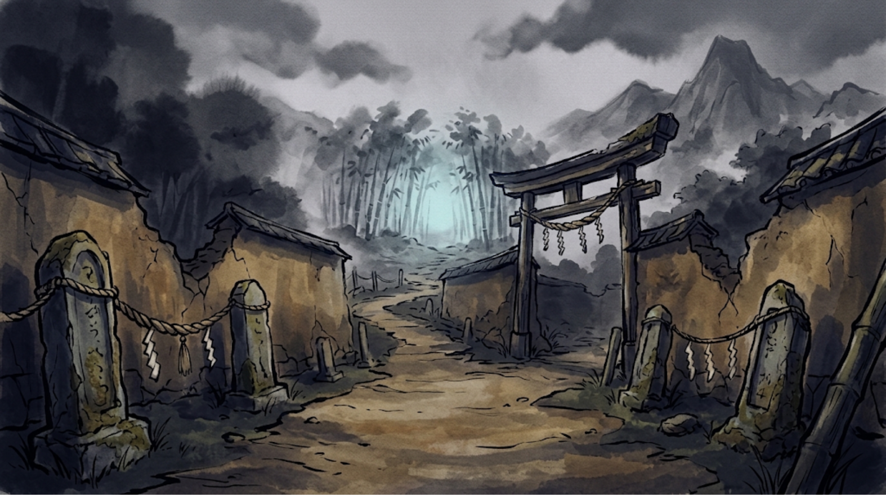
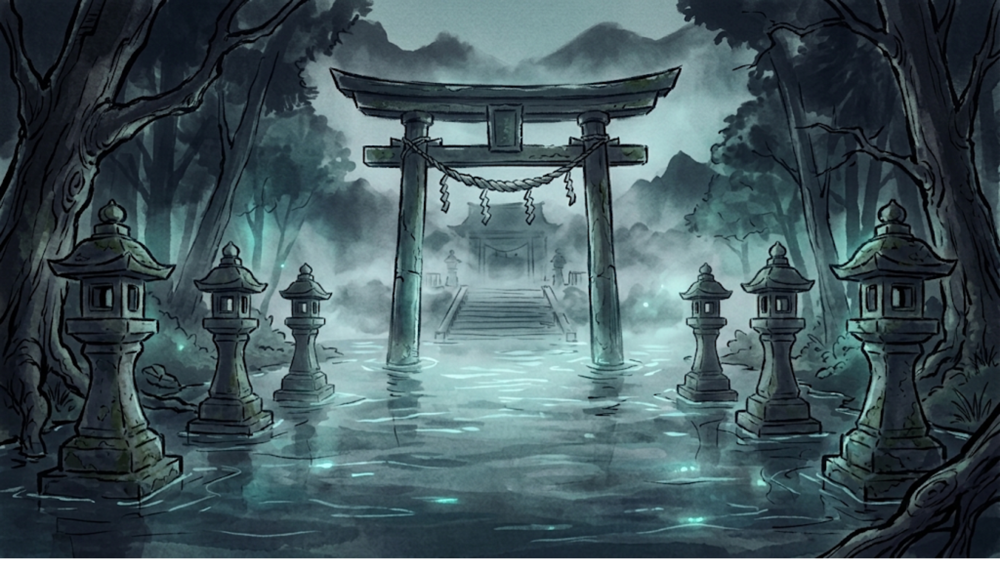
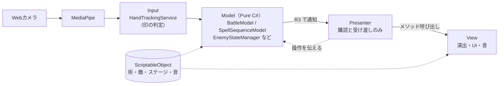
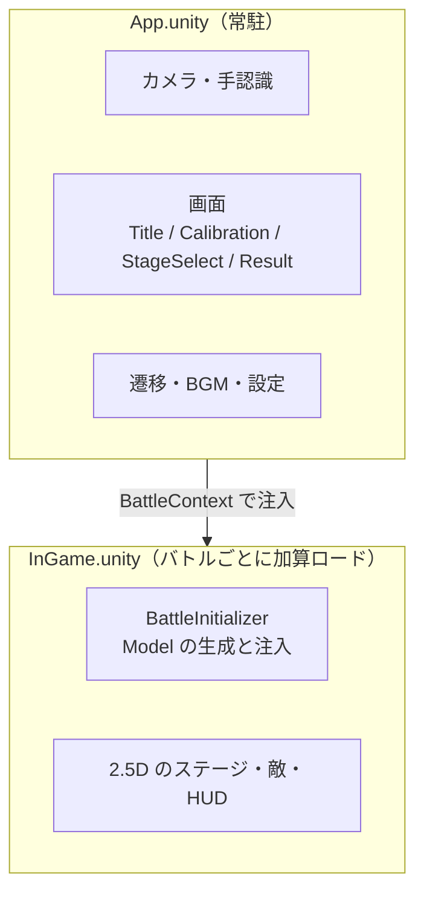

<div align="center">

# MUDRA

**手印（ムドラ）を組んで、術を放て。**

Webカメラに映した手の形が、そのまま術の詠唱になるボス戦アクションゲーム


▶ **[デモ動画（YouTube）準備中]()**

▶ **[ダウンロードサイト（itch.io）](https://kapi-0622.itch.io/mudra)**

</div>

---

## 概要

NARUTO や呪術廻戦の「印を結んで技を出す」あの感覚を、コントローラーではなく**自分の手そのもの**で体験できないか ── という原体験から生まれた個人開発プロジェクトです。

- 手の21点の関節位置を MediaPipe で取り、**指の曲げ伸ばしから印を自前で判定**しています（学習済みの分類モデルは使っていません）
- 印の**組み合わせ**で術が決まり、ボスの攻撃の合間を縫って詠唱する、リアルタイムのボス戦です
- 企画・仕様・設計・実装・ドキュメントまで**一人で**行っています

| 数字で見る MUDRA | |
|---|---|
| 開発期間 | 2026/06/28〜（途中約1.5か月の中断あり） |
| コード | **125ファイル**（C#。サードパーティを除く） |
| 手印 | **10種**（片手8種＋両手2種） |
| 術 | **11種**（6属性。単発・多段・継続ダメージ・スタン・回復） |
| ステージ | **4ステージ＋チュートリアル**（道中の雑魚戦 → ボス戦。敵15種） |
| サウンド | BGM 12曲・効果音 41素材 |
| 開発ログ | マイルストーンごとの devlog **16本**、仕様書 v1.9 |

## スクリーンショット

<table>
  <tr>
    <td></td>
    <td></td>
  </tr>
  <tr>
    <td align="center">Stage 1 封土の里</td>
    <td align="center">Stage 2 水底の社</td>
  </tr>
  <tr>
    <td></td>
    <td></td>
  </tr>
  <tr>
    <td align="center">Stage 3 焔の廃寺</td>
    <td align="center">Stage 4 影の深淵</td>
  </tr>
  <tr>
    <td></td>
    <td></td>
  </tr>
  <tr>
    <td align="center">キャリブレーション（カメラと手の確認）</td>
    <td align="center">リザルト（ランクと記録）</td>
  </tr>
</table>

## 遊び方

1. Webカメラの前で**詠唱印**を順に組む。手を止めて約0.15秒で印が確定する
2. 組み合わせが揃ったら**発動印「発」**で術を放つ。間違えたら**解除印「散」**でやり直し
3. ボスは「予告 → 溜め → 攻撃」を繰り返す。攻撃に合わせて**ガード印「盾」**を組むと軽減できる
4. 弱点属性・詠唱の速さ・コンボで威力が上がる。登録にない組み合わせで発動すると**暴発**して自分が傷つく

「被弾覚悟で大技の詠唱を続けるか、手を止めてガードするか」の判断がゲームの核です。

### 手印

| 種類 | 印 | 手の形 |
|---|---|---|
| 詠唱印 | 開 | パー（全指を開く） |
| | 握 | グー（全指を握る） |
| | 指 | 人差し指だけ伸ばす |
| | 刃 | チョキ |
| | 掌 | 親指だけ折る |
| 両手印 | 合 | 両手を合わせる |
| | 双 | 両手でチョキ |
| 発動印 | 発 | 親指を曲げ、人差し指と小指を伸ばす |
| 解除印 | 散 | 小指だけ伸ばす |
| ガード印 | 盾 | 親指だけ伸ばす |

### 術の例

| 術 | 詠唱 | 効果 |
|---|---|---|
| 火炎弾（火） | 掌 → 握 | 継続ダメージ |
| 雷連撃（雷） | 指 → 刃 | 多段ヒット＋スタン |
| 回復術 | 開 → 掌 | 時間をかけて回復 |
| 業火（火） | 掌 → 握 → 指 → 開 | 4印の大技 |
| 風刃（風） | 合 | 両手印1つで放つ |

## 見どころ

### 1. 推測で直さず、計測から直した手印認識

「反応が鈍く誤判定が多い」という課題に、最初は FPS 低下を疑いました。計測すると FPS は約170で十分な一方、**手の推論は25〜35回/秒**しか回っておらず、本当の問題は「印を組み替える途中の形が確定してしまう」ことでした。
そこで、確定時間をフレーム数ではなく秒で数え、指の判定にヒステリシスを入れ、**手が止まっている間だけ確定時間を進める**静止判定を作りました。手の速さは手のひら長で割ってカメラとの距離に依存しないようにし、閾値は保持中・組み替え中の実測値から決めています。誤確定を抑えたまま、確定時間を **0.23秒 → 0.15秒** に短縮しました。
→ [`HandTrackingService.cs`](MUDRA/Assets/_MUDRA/Scripts/Input/HandTrackingService.cs) ／ [devlog B4.5](MUDRA/docs/devlog/dev_log_B4.5.md)

### 2. 両手印を「片手の判定の組み合わせ」で作る

左右それぞれに片手の判定をかけ、その結果の組み合わせを両手の表と照合する**2段階のテーブル判定**にしました。片手のロジックをそのまま再利用でき、新しい両手印は表に1行足すだけで追加できます。両手が合わさっているかは**手のひら長に対する比率**で判定し、カメラとの距離に左右されません。両手を近づける途中で片手の印が先に確定する問題には、「2本見えている間は片手印を判定しない」ルールで対処しました。
→ [`HandTrackingService.cs`](MUDRA/Assets/_MUDRA/Scripts/Input/HandTrackingService.cs) ／ [devlog B2](MUDRA/docs/devlog/dev_log_B2.md)

### 3. 2D → 2.5D に作り替えて、ゲームロジックの差分はゼロ

2Dで作っていたバトル画面を、3D空間に絵の板を並べる「書き割り」の2.5Dに移行しました。ゲームロジック（Model 層）を Pure C# に保っていたため、**Model の変更は0行**、入力層と HUD も無改造です。
カメラ距離を **8.66**（FOV 60° で見える高さ10 ＝ 2D 時代の画面と同じ）にして、2D で調整した座標や揺れ幅をそのまま引き継ぎました。移行前に**性能計測ツールを自作**して基準値を取り、FPS と推論回数が落ちていないこと（定期的なフレーム落ちは 9回 → 0回）を確認しています。
→ [`StageEnvironmentView.cs`](MUDRA/Assets/_MUDRA/Scripts/View/StageEnvironmentView.cs) ／ [`PerformanceRecorder.cs`](MUDRA/Assets/_MUDRA/Scripts/Debug/PerformanceRecorder.cs) ／ [devlog B6.5](MUDRA/docs/devlog/dev_log_B6.5.md)

### 4. 重なっても壊れない演出 ──「成分ごとに持って1か所で合成」

敵には予告の明滅・被弾フラッシュ・影からの登場・揺れが同時に重なります。各演出が直接色や位置を書くと上書きし合うため、**演出ごとに自分の成分だけを持ち、1か所で合成**する形にしました。後からポーズを足した際に「ヒットストップの終わりにポーズが勝手に解ける」問題が出たときも、同じ考え方で `Time.timeScale`（ポーズ・ヒットストップ・スロー）を合成し、書き込むクラスを1つに限定して解決しています。
→ [`EnemyView.cs`](MUDRA/Assets/_MUDRA/Scripts/View/EnemyView.cs) ／ [`TimeScaleView.cs`](MUDRA/Assets/_MUDRA/Scripts/View/TimeScaleView.cs) ／ [devlog B4](MUDRA/docs/devlog/dev_log_B4.md)・[B5](MUDRA/docs/devlog/dev_log_B5.md)

### 5. 遊びと実装の両面から仕様を変えた「タイミングガード」

当初は「グーを握り続けるとガード」でしたが、大技の前に構えっぱなしにできて単調なうえ、詠唱中のグーとガードのグーを文脈で区別する複雑な判定が必要でした。**専用のガード印を組んだ瞬間から0.5秒だけ軽減窓が開く**方式に変え、「予告を見て合わせる」攻略感を生みつつ、文脈判定と状態の解除検出を丸ごと不要にしました。
→ [`GuardWindowManager.cs`](MUDRA/Assets/_MUDRA/Scripts/Model/StatusEffect/GuardWindowManager.cs) ／ [devlog A5](MUDRA/docs/devlog/dev_log_A5.md)

## 技術スタック

| カテゴリ | 技術 | 用途 |
|---|---|---|
| エンジン | Unity 6（6000.4.4f1）／URP | App は 2D Renderer、バトルは Universal Renderer |
| 手認識 | [MediaPipeUnityPlugin](https://github.com/homuler/MediaPipeUnityPlugin) | 手の21点の関節位置の検出 |
| リアクティブ | [R3](https://github.com/Cysharp/R3) | Model → Presenter の通知 |
| 非同期 | [UniTask](https://github.com/Cysharp/UniTask) | 敵の行動ループ・遷移・待機（コルーチン不使用） |
| 演出 | [LitMotion](https://github.com/annulusgames/LitMotion)・Cinemachine 3・Particle System | トゥイーン、カメラの移動と揺れ |
| サウンド | AudioMixer・Audio Random Container | 音量設定、効果音の音程のばらつき |
| データ | ScriptableObject | 術・敵・ステージ・演出の尺と色・音 |
| ターゲット | Windows スタンドアロン | MediaPipeUnityPlugin が WebGL 非対応のため |

## アーキテクチャ

**MVP（Model-View-Presenter）**。Model はすべて Pure C#（MonoBehaviour 非継承・Unity API 不使用）で、通知は常に一方向です。



シーンは、カメラと手認識を載せて**常駐する App** と、バトルのたびに**加算ロードする InGame** の2つです。バトルやリトライのたびに Webカメラと推論を初期化し直さずに済みます。



生成と依存の注入は `AppInitializer` と `BattleInitializer` の2か所に集約し、DI コンテナやシングルトンは使っていません。詳しくは [architecture/00_overview.md](MUDRA/docs/architecture/00_overview.md)。

<details>
<summary><b>初期の設計判断（Prototype〜α版）</b></summary>

- **State と enum を要件で使い分け**: プレイヤーは同じ入力を状態ごとに違う処理をするので State パターン、敵は「時間が経ったら次へ」の共通形なので enum＋switch＋UniTask
- **ダメージ計算は Strategy パターン**: 単発・多段・継続ダメージを `IDamageCalculator` の実装で差し替え
- **状態異常の共通ライフサイクル**: `IStatusEffect`（OnApply / OnTick / OnExpire）で共通化し、作用先（敵の状態・HP）は各効果に委譲
- **サードパーティへの変更を最小化**: MediaPipe 側への手入れは event の追加1点だけ。ゲームのロジックは別クラスに分離
- **Prototype で意図的に積んだ負債を α版で計画的に返済**: static event → Pull 型の `IHandLandmarkProvider`、`event Action` → R3、ハードコード → ScriptableObject

</details>

<details>
<summary><b>フォルダ構成</b></summary>

```
MUDRA/Assets/_MUDRA/Scripts/
├── Input/        印の判定（HandTrackingService）と MediaPipe からの取得
├── Model/        ゲームロジック（Pure C#）
│   ├── State/        プレイヤーの状態
│   ├── Strategy/     ダメージ計算
│   └── StatusEffect/ 状態異常・ガード受付窓
├── Presenter/    購読の配線、AppInitializer / BattleInitializer
├── View/         演出・UI・音（SePlayer / BgmPlayer）
├── Data/         ScriptableObject の定義
├── Persistence/  セーブ（JSON）
├── Debug/        キーボード入力・デバッグメニュー・性能計測
└── Editor/       敵・ステージのデータ一括生成など
```

</details>

## 開発の進め方

- **仕様駆動**: 仕様書を拠り所にし、実装でずれた点は都度仕様書へ戻す（現在 v1.9）
- **マイルストーンごとに devlog**: 比較した案と選んだ理由・つまずいた点・技術的負債・次への引き継ぎを記録
- **小さく区切って実機確認**: ステップごとに「提案 → 承認 → 実装 → Webカメラで確認」してから次へ
- **計画外の課題は別工程に切り出す**: 遊んでみて分かった認識の鈍さ（B4.5）と見た目の奥行き（B6.5）は、完了条件を決めてから着手
- **AI の使い方**: 設計相談・調査・コードレビュー（PR には CodeRabbit の自動レビュー）に活用。C# は自分で書き、シーン・アセットの組み立ては Unity MCP 経由で AI に任せる分担
- **カメラなしで全機能を試せる**: 判定結果の印をキーボードで差し替えるデバッグモードと、デバッグメニュー（製品ビルドからは除外）

| フェーズ | 内容 | 状態 |
|---|---|---|
| Prototype P1〜P3 | MediaPipe 接続、手印判定、1術発動の最小デモ | ✅ |
| α版 A1〜A5 | MVP 基盤、バトルループ、術と Strategy、UI、ガード・状態異常（予定より8日前倒し） | ✅ |
| β版 B1〜B2 | デバッグ基盤、両手印 | ✅ |
| β版 B3〜B4 | 全4ステージ、バトル演出・UI | ✅ |
| β版 B4.5 | 手印認識の改善（追加工程） | ✅ |
| β版 B5〜B6 | ゲームフロー、キャリブレーション・チュートリアル | ✅ |
| β版 B6.5 | バトル画面の 2.5D 化（追加工程） | ✅ |
| β版 B7 | サウンド（BGM・効果音・音量設定） | ✅ |
| β版 B8〜B9 | バランス調整、バグ修正・ビルドの安定化 | 🔜 次 |

## 動かし方

**必要なもの**: Windows PC、Unity 6000.4.4f1、Webカメラ（無くてもキーボードで遊べます）

1. このリポジトリをクローンし、Unity Hub で `MUDRA/` フォルダを開く
   （MediaPipe はリポジトリに同梱。UniTask・LitMotion は git URL、R3 は NuGetForUnity で自動的に入ります）
2. `Assets/_MUDRA/Scenes/App.unity` を開いて再生
   （InGame を開いて再生しても、メニュー `MUDRA/Play From App Scene` が ON なら App から始まります）

<details>
<summary><b>カメラなしで遊ぶ（キーボードモード）</b></summary>

InGame の `HandSignPresenter` の `Debug Keyboard Input` に `DebugKeyboardInput` を割り当てると有効になります。
キャリブレーションは `F2`、チュートリアルは `Tab` で抜けられます。

| キー | 操作 |
|---|---|
| `1`〜`5` | 詠唱印（開・握・指・刃・掌） |
| `U` | 合（両手印） |
| `Space` | 発動 |
| `Backspace` | 解除 |
| `G` | ガード |
| `R` | リトライ |
| `F1` | デバッグメニュー |

</details>

## ドキュメント

| ドキュメント | 内容 |
|---|---|
| [architecture/](MUDRA/docs/architecture/) | 今のコードの構成図（全体・手の入力・バトル・サウンド） |
| [specification_MUDRA.md](MUDRA/docs/specification_MUDRA.md) | 仕様書 v1.9（未実装のものを含む） |
| [proposal_MUDRA.md](MUDRA/docs/proposal_MUDRA.md) | 企画書・世界観 |
| [hand_sign_tuning.md](MUDRA/docs/hand_sign_tuning.md) | 手印認識の閾値の調整手順 |

<details>
<summary><b>開発ログ（devlog）16本</b></summary>

| devlog | 内容 |
|---|---|
| [P2](MUDRA/docs/devlog/dev_log_P2.md) | MediaPipe 接続・3種の手印判定 |
| [P3](MUDRA/docs/devlog/dev_log_P3.md) | 術発動の最小デモ |
| [A1](MUDRA/docs/devlog/dev_log_A1.md) | アーキテクチャ再構築・技術的負債の返済 |
| [A2](MUDRA/docs/devlog/dev_log_A2.md) | バトルループ・BattleInitializer |
| [A3](MUDRA/docs/devlog/dev_log_A3.md) | 親指判定・手印拡充・ダメージ計算 Strategy |
| [A4](MUDRA/docs/devlog/dev_log_A4.md) | HP バー・シーケンスガイド・テロップ |
| [A5](MUDRA/docs/devlog/dev_log_A5.md) | タイミングガード・状態異常（スタン・継続ダメージ） |
| [B1](MUDRA/docs/devlog/dev_log_B1.md) | デバッグ基盤・β版の再計画 |
| [B2](MUDRA/docs/devlog/dev_log_B2.md) | 両手印 |
| [B3](MUDRA/docs/devlog/dev_log_B3.md) | 全ステージ・セクション進行 |
| [B4](MUDRA/docs/devlog/dev_log_B4.md) | バトル演出・UI 強化 |
| [B4.5](MUDRA/docs/devlog/dev_log_B4.5.md) | 手印認識の改善 |
| [B5](MUDRA/docs/devlog/dev_log_B5.md) | ゲームフロー（画面遷移・ポーズ・セーブ） |
| [B6](MUDRA/docs/devlog/dev_log_B6.md) | キャリブレーション・チュートリアル |
| [B6.5](MUDRA/docs/devlog/dev_log_B6.5.md) | バトル画面の 2.5D 化 |
| [B7](MUDRA/docs/devlog/dev_log_B7.md) | サウンド |

</details>

## クレジット

- 手認識: [MediaPipeUnityPlugin](https://github.com/homuler/MediaPipeUnityPlugin)（homuler）
- 画像素材（背景・敵・ステージの環境）: 画像生成AIで作成し、取り込み・切り抜き・配置の調整は自前で行っています
- 効果音・BGM: フリー素材サイトの素材を利用しています
- フォント: 衡山毛筆フォント、しっぽり明朝、筆ごしらえ

## 作者

**Kapi0622** ── [GitHub](https://github.com/Kapi0622)

本リポジトリはポートフォリオとして公開しています。コード・素材の再配布はご遠慮ください。
